# Megnézendő filmek és sorozatok – felhasználói leírás

Ez az app kézikönyve: minden, amit tud, témák szerint, képekkel. Nem kell az elejétől a végéig
elolvasni – ugorj oda, ami épp érdekel. Ahol egy képen sok minden van, kis borostyánszínű számok
(①②③) jelölik a részeit, és a szöveg ugyanezekkel a számokkal mesél róluk.

Időről időre frissül, nem minden apró változás után – így előfordulhat, hogy a felület már egy
kicsit előrébb jár. A nagyobb állomásokat a végén, a **Mérföldkövek** között találod.

Utolsó frissítés: 2026. 10. 22. · Élő oldal: https://filmlista-six.vercel.app/

> Tipp: VS Code-ban a **Ctrl+Shift+V** formázott előnézetben nyitja meg ezt a leírást – így a képek
> is látszanak.

## Tartalom

1. [Belépés és telepítés](#1-belépés-és-telepítés)
2. [A lista: nézetek és lapozás](#2-a-lista-nézetek-és-lapozás)
3. [Szűrés, keresés, rendezés](#3-szűrés-keresés-rendezés)
4. [Címek felvétele](#4-címek-felvétele)
5. [Egy cím adatlapja és szerkesztése](#5-egy-cím-adatlapja-és-szerkesztése)
6. [Állapotok, letöltve, értékelések](#6-állapotok-letöltve-értékelések)
7. [Sorozatok és évadok](#7-sorozatok-és-évadok)
8. [Még meg nem jelent filmek](#8-még-meg-nem-jelent-filmek)
9. [Franchise-ok és gyűjtemények](#9-franchise-ok-és-gyűjtemények)
10. [Mama-jelölések](#10-mama-jelölések)
11. [Értesítések](#11-értesítések)
12. [IMDb](#12-imdb)
13. [Statisztika](#13-statisztika)
14. [Mentések és adatbiztonság](#14-mentések-és-adatbiztonság)
15. [Telefonon](#15-telefonon)
16. [Billentyűzet, kényelmi apróságok](#16-billentyűzet-kényelmi-apróságok)
17. [Honnan jönnek az adatok?](#17-honnan-jönnek-az-adatok)
18. [Mérföldkövek](#18-mérföldkövek)

---

## 1. Belépés és telepítés

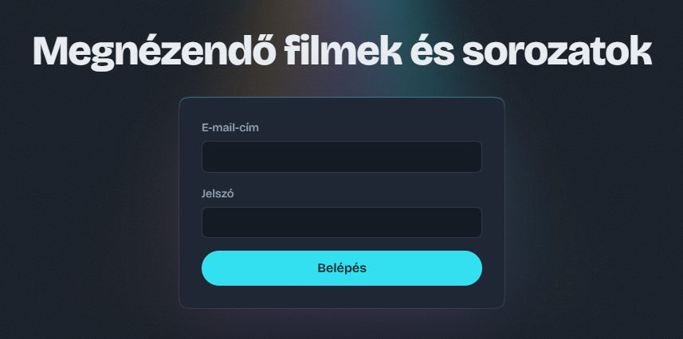

**Belépés:** e-mail-cím, jelszó, **Belépés** – és már bent is vagy. A böngésző megjegyzi, így nem
kell minden alkalommal újra begépelned. Regisztrálni nem lehet; új fiókot csak a Supabase
felületén lehet létrehozni. Ha végeztél, a **Kilépés** gombot a fejlécben, az e-mail-címed mellett
találod – net nélkül is működik (ilyenkor helyben léptet ki, pár másodperc alatt). (Mama a saját
fiókjával lép be, és nem a listádat, hanem a saját, egyszerű oldalát látja – lásd
[10.](#10-mama-jelölések).)

**Jelszó módosítása:** kattints a fejlécben az e-mail-címedre (vagy ⋮ menü → **Jelszó módosítása**).
Írd be a jelenlegi jelszavadat, aztán kétszer az újat (legalább 8 karakter), és **Jelszó mentése**. Az
app előbb ellenőrzi a régit, és ha minden rendben, „A jelszavad megváltozott” – bejelentkezve maradsz.
Elfelejtett jelszót itt nem lehet kérni.

**Legyen saját ablaka!** Az app telepíthető, mintha rendes program lenne:
- *Számítógépen (Chrome / Edge):* a címsor jobb szélén a „Telepítés” ikon. Utána a Start menüből és
  a tálcáról indul, saját ikonnal (türkiz filmcsapó sötét alapon), böngészősáv nélkül.
- *Telefonon:* a böngésző menüjében „Hozzáadás a kezdőképernyőhöz”.
- Bónusz: a telepített app ikonján egy kis szám jelzi, ha olvasatlan értesítésed van (ahol a
  rendszer tudja ezt).
- **Gyorsindítók:** jobb klikk a telepített app ikonjára (a tálcán vagy a Start menüben; telefonon
  hosszan nyomva), és rögtön oda ugorhatsz, ahová épp mennél: **Cím hozzáadása**, **Franchise-ok**
  vagy **Statisztika**. Az app elindul, és a lista betöltése után magától megnyitja. (Ha az app már
  korábban telepítve volt, a Chrome néha csak az app újraindítása után mutatja ezeket.)

**Net nélkül is elindul:** az app megjegyzi a legutóbb látott listádat, így indításkor **azonnal**
ott van – nem kell a betöltésre várnod. A friss lista a háttérben érkezik (addig a darabszám mellett
„· frissítés…” áll), és magától a helyére lép.

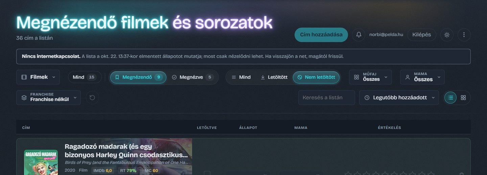

Ha épp nincs internet (vonaton, rossz wifin), az app akkor is elindul, és a legutóbb elmentett
listát mutatja. Fölötte sáv jelzi: „**Nincs internetkapcsolat.** A lista a … -kor elmentett állapotot
mutatja; most csak nézelődni lehet. Ha visszajön a net, magától frissül.” Ilyenkor böngészni,
szűrni, keresni és az adatlapokat nézegetni lehet, módosítani viszont nem: a **Cím hozzáadása** gomb
és a lista vezérlői halványan, tiltva látszanak, az adatlap mezői fölött pedig ott áll: „Kapcsolat
nélkül csak nézelődni lehet.” A Hasonló címeknél, a gyűjtemény-ablakban és a Franchise-ok ablakban
sincs felvétel vagy átnevezés, a ⋮ menüből pedig kimarad a Színészek és rendezők, a Toplisták, az
IMDb import, a Tömeges import, a Mentések, a Hibák és a Jelszó módosítása. Amint visszajön a net, a
sáv eltűnik, és minden újra a régi. (Ez a borítókra is igaz, amiket már láttál – a listád borítói
net nélkül is megmaradnak; a még sosem látott képek helyén üres hely lesz.)

Ugyanez a „csak nézelődés” látszik indításkor is egy pillanatra, amíg a friss lista meg nem érkezik
(az adatlapon: „A lista még nem frissült – addig csak nézelődni lehet.”). Ha a szerver épp nem
érhető el, alul sáv szól róla, és az app hamarosan magától újrapróbálja.

## 2. A lista: nézetek és lapozás

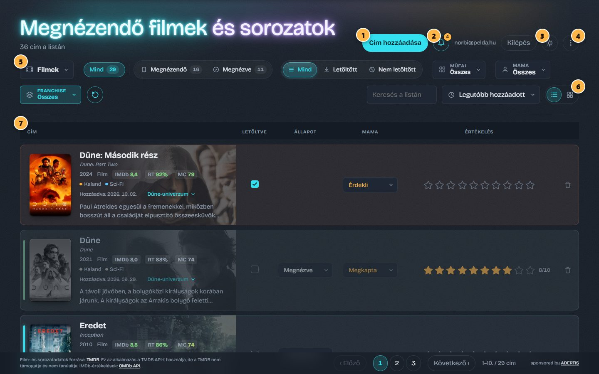

Ez a főoldal, itt él a listád. Fent a cím **neonfeliratként** világít: a betűk az üvegcsövek, a fény
a mögöttük lévő falra vetül. Egy munkamenetben egyszer, az első megnyitáskor fel is villan, mintha
most kapcsolnád fel (a „kevesebb mozgás” beállításnál rögtön ég). A fejlécben:
- ① **Cím hozzáadása** – új film vagy sorozat felvétele (lásd [4.](#4-címek-felvétele));
- ② a **harang** – értesítések új évadokról, megjelenésekről, követett színészekről (lásd
  [11.](#11-értesítések));
- mellette az e-mail-címed (rákattintva jelszót módosíthatsz – lásd [1.](#1-belépés-és-telepítés))
  és a **Kilépés**;
- ③ a **téma** váltógombja – nap: világos téma, hold: sötét (lásd lent);
- ④ a **⋮ További műveletek** menü – a ritkábban kellő dolgok gyűjtőhelye.

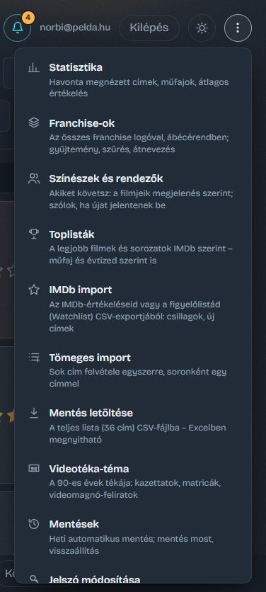

A ⋮ menüben minden pont alatt rövid leírás is áll, hogy ne kelljen találgatnod: **Statisztika**,
**Franchise-ok**, **Színészek és rendezők** (lásd [5.](#5-egy-cím-adatlapja-és-szerkesztése)),
**Toplisták** (lásd [4.](#4-címek-felvétele)), **IMDb import**, **Tömeges import**, **Mentés
letöltése**, **Videotéka-téma** (lásd lent), **Mentések**, **Jelszó módosítása**, a **Felhasználói
leírás** – ez a kézikönyv, az appon belül, egy ablakban (telefonon és net nélkül is) –, és ha valami
elromlott, a végén a **Hibák** (lásd [14.](#14-mentések-és-adatbiztonság)).

⑤ A fejléc alatt a **szűrősor** (részletek a [3.](#3-szűrés-keresés-rendezés) pontban), ⑥ a jobb
szélén pedig a **nézetváltó**: két kis ikon, lista vagy rács. A kiválasztott ikon halvány türkiz
háttere a váltáskor átsiklik a másikra.

**Görgetéskor a fejléc félreáll:** lefelé görgetve a nagy cím összemegy, a fejléc sávja felgördül, és
a szűrősor tapad a lap tetejére. A jobb szélén ilyenkor kis kerek gombok bukkannak fel: **↑** (vissza
a lap tetejére), **+** (Cím hozzáadása), a **harang** és a **⋮** – így ezek mindig kéznél vannak. A
Kilépés, a téma és az e-mail-címed csak a lap tetején, a nyitott fejlécben látszik. (Telefonon a
fejléc keskeny sávvá csukódik, és a lebegő **+** marad – lásd [15.](#15-telefonon).)

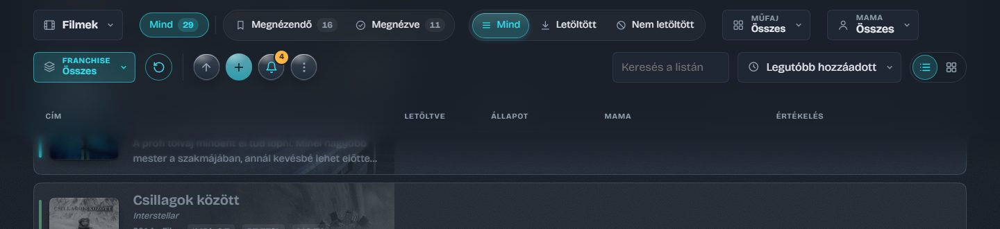

**Világos vagy sötét?** A fejléc nap / hold gombjával váltasz. Az alap a sötét; a világos meleg,
krémes „papír” – nappal, erős fényben kellemesebb. A választást a böngésző megjegyzi (Mamánál a
világos az alap, és az ő oldalán felirat is van a gombon: „Világos” / „Sötét”).

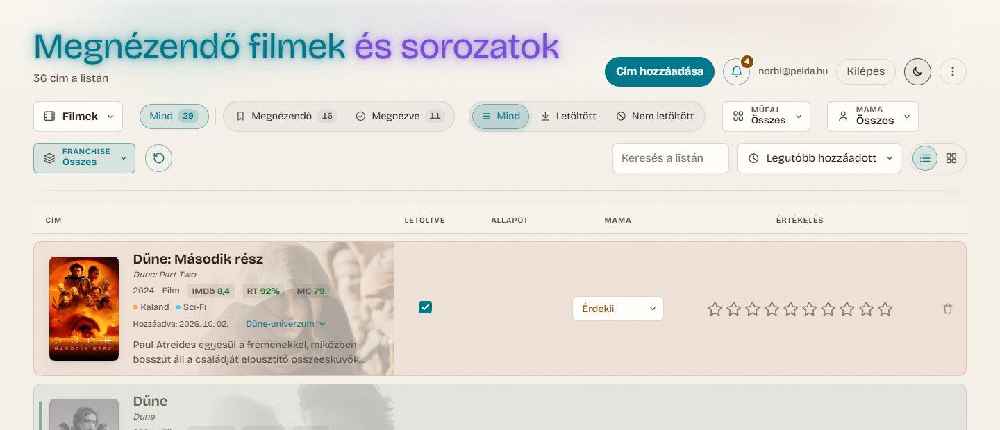

**Videotéka-téma – egy kis nosztalgia:** a ⋮ menü **Videotéka-téma** pontjával a 90-es évek
tékájába csöppensz. Éjszakai lilás-fekete háttér halvány képcsíkokkal, rózsaszín-sárga neonfelirat,
a borítók fekete kazettatokban, alul a műfaj nagybetűs „kategóriacímkéje” (AKCIÓ, DRÁMA…), az
elmúlt héten felvett címeken sárga **ÚJ!** matrica, a saját értékelésed árcédulán („8/10”), az
állapotok videomagnó-feliratként („▶ LEJÁTSZÁS”, „■ VÉGE”, „⏏ KIADVA”). Az adatlap jelenetképén
„▶ PLAY SP”, a Statisztika tagsági kártyás, a Toplisták pedig „A hét slágerei”. Kikapcsolni ugyanott
lehet (**Videotéka-téma kikapcsolása** – vissza a sötétre), vagy a nap gombbal a világosra. Mama
oldalán nincs ilyen.

**Két nézet, ahogy kedved tartja:**
- **Lista (táblázat)** – csak széles képernyőn (legalább 1400 px). ⑦ Soronként egy kártyaszerű sor,
  halványan a film színében, a cím mögött a film jelenetképével: borító, cím (eredeti címmel, évvel,
  az IMDb-, a Rotten Tomatoes- és a Metacritic-értékkel, műfajokkal), franchise, a TMDB leírása,
  Letöltve, Állapot, Mama, Saját értékelés és a kuka. Szinte mindent helyben, a sorban át tudsz
  állítani (lásd
  [5.](#5-egy-cím-adatlapja-és-szerkesztése)).
- **Rács (borítófal)** – nagy borítók kártyákon. 1400 px alatt mindig ez látszik.
- A választásodat a böngésző megjegyzi. Váltáskor a borítók egymás után a helyükre siklanak.

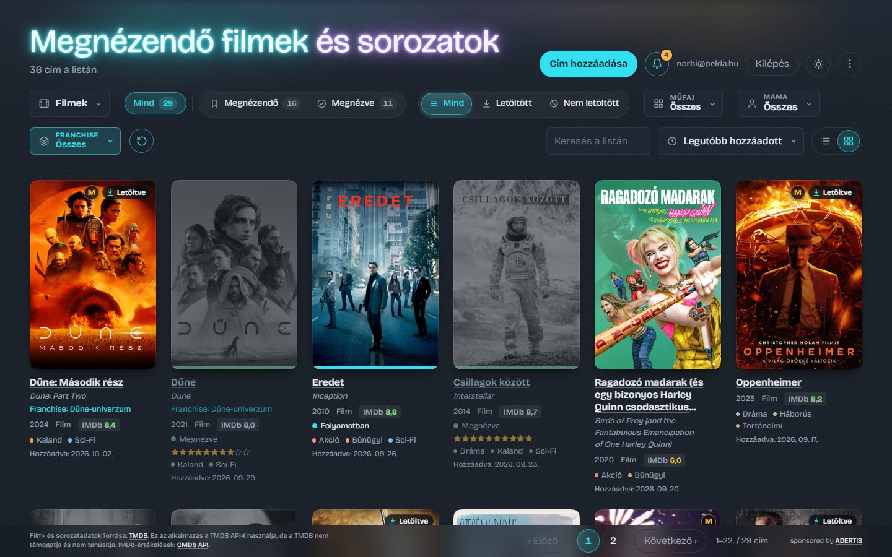

**Egy kártyán** ott van minden fontos: borító (ha rámutatsz, a borító színében felfénylik), cím
(legfeljebb három sorban – a teljes cím rámutatva látszik; rákattintva az IMDb-adatlap nyílik, ha
nincs IMDb-azonosító, a TMDB-é), eredeti cím, év, típus, IMDb-érték, műfajok színes pöttyel, a saját
értékelésed kis csillagokkal, „Hozzáadva: <dátum>”, és a borító jobb felső sarkában a jelvények:
„Letöltve”, ha le van töltve, és egy borostyánszínű **„M”**, ha Mamát érdekli (lásd
[10.](#10-mama-jelölések)). Sorozatnál, ha új évadot jelentettek be, a borítón indigó jelvény is
áll: „3. évad · dec. 8.” (ha még nincs dátum: „3. évad · hamarosan”). A **borítóra** kattintva az
adatlap nyílik.

**Az értékelések színe:** az IMDb-, a Rotten Tomatoes- és a Metacritic-szám a skála színét kapja –
40 alatt piros, 60 körül sárgás, 80-tól zöld –, így egy pillantásra látod, mennyire jó egy cím. A
megnézett címeken szürke (rámutatva színes). A kártyán csak az IMDb látszik, a másik kettő a lista
nézetben és az adatlapon (lásd [12.](#12-imdb)).

**Lapozás:** lista nézetben oldalanként 10 cím, telefonon és keskenyebb rácsban 25, asztali rácsban
22 (1440p-n ez soronként 11 kártya, vagyis két szép, teli sor). Széles képernyőn (1400 px-től) – a
rácsban és a listában is – a lapozó és a lábléc egy közös üvegsávban **mindig az ablak alján** ül: „‹
Előző 1 2 3 Következő ›”, mellette „1–10. / 29 cím” – így minden oldalon pontosan ugyanott találod.
Lista és rács között váltva az az oldal jön, amelyiken az addig látott első cím van, szóval nem
veszted el a fonalat. Ha szűrsz, rendezel vagy keresel, az 1. oldalra ugrik; lapozáskor a lista
tetejére görget, és a kártyák egymás után beúsznak.

**Betöltés közben** a lista helyén halványan csillogó „csontváz” jelzi, hogy mindjárt jön minden –
de csak a legelső alkalommal: utána az app azonnal a legutóbb látott listát mutatja, és a háttérben
frissíti (lásd [1.](#1-belépés-és-telepítés)).

**Mindig friss, magától:**
- **Élő szinkron:** ha egy másik gépen vagy telefonon módosítasz valamit (vagy Mama jelöl egy
  filmet), pár másodpercen belül itt is megjelenik – újratöltés nélkül.
- Ha az app legalább 5 percig a háttérben volt, visszatéréskor csendben frissíti a listát (a
  szűrők, a lapozás, a nyitott adatlap marad).
- **„Frissült az app”:** ha közben új változat jelent meg, alul sáv szól: „Frissült az app – az
  újratöltéssel az új változat indul.” → **Újratöltés**.
- A címek adatai (magyar cím, ha eddig csak az eredeti állt ott; leírás, borító, megjelenési dátum,
  műfajok) havonta frissülnek a TMDB-ről, a még meg nem jelent filmek hetente – a kézzel adott címed
  nem íródik felül.

## 3. Szűrés, keresés, rendezés

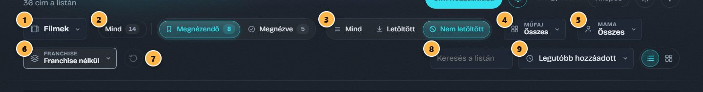

A szűrősorral pillanatok alatt arra szűkítheted a listát, ami épp érdekel. Balról jobbra:

| | Szűrő | Lehetőségek |
|---|---|---|
| ① | Típus | Filmek / Sorozatok (franchise-ra szűrve vagy keresés közben: Filmek és sorozatok is) |
| ② | Állapot | **Mind**, mellette egy közös sávban ikonnal: Megnézendő · Megnézve, sorozatoknál Folyamatban és Abbahagyva is – mindegyik mellett a darabszám, ami a többi szűrőt is figyelembe veszi; a kiválasztott halvány türkiz háttere váltáskor átsiklik az újra |
| ③ | Letöltés | gombcsoport: Mind / Letöltött / Nem letöltött – egy kattintással vált |
| ④ | Műfaj | az adott típus műfajai rácsban, mindegyik a saját kis ikonjával és a darabszámmal (a 0 darabos halvány) |
| ⑤ | Mama | Összes / Érdekli / Nem érdekli / Megkapta – csak ha van Mama-jelölés; Sorozatoknál és franchise-ra szűrve nem látszik (ott nincs értelme, lásd [10.](#10-mama-jelölések)) |
| ⑥ | Franchise | Összes / Franchise nélkül / a franchise-aid logóval, két csoportban: fölül **Van még megnézendő** („2 hátra” címkével), alul halványan **Mind megnézve** – egy franchise kiválasztásakor az Állapot magától „Mind” lesz (lásd [9.](#9-franchise-ok-és-gyűjtemények)) |

A lenyílók (Típus, Műfaj, Mama, Franchise, Rendezés) üveges panelben nyílnak, ikonokkal és
darabszámmal, a kiválasztott mellett pipa. Ha egy szűrő nem az alapállapotában áll, a gombja halvány
türkiz – így látod, mire szűrsz. (Telefonon a megszokott lenyílók maradnak – lásd
[15.](#15-telefonon).)

⑦ **Vissza alapállapotba (↺):** egy kattintás, és minden szűrő visszaáll erre: Filmek – Megnézendő
– Nem letöltött – Összes műfaj – Franchise nélkül (rámutatva ki is írja). Betöltéskor is így indul.
Ha valamit átállítottál, a ↺ élénk, alapállapotban halvány – így első ránézésre látod, szűrsz-e épp
valamire.

⑧ **Keresés a listán:** a címben, az eredeti címben és a **franchise nevében** keres, és nem zavarja
a kis- és nagybetű vagy az ékezet („dune” is megtalálja a „Dűne”-t). Több szónál mindegyiknek
szerepelnie kell. Gépelés közben az **egész listádon** keres – a szűrők félreállnak, de közben
szűkítheted őket –, a keresés törlésekor pedig visszakapod a korábbi szűrőidet.
- **Elírást is elnéz:** ha egy (legalább 5 betűs) szóra nincs pontos találat, egy betűnyi elírással
  is keres, és a lista fölött szól: „Nincs pontos találat a „dűnne” szóra – a hasonlókat mutatjuk:
  „dűne””.
- A találatban a keresett rész halk türkiz aláhúzást kap; ha a franchise neve miatt került be egy cím,
  a lista fölött jelzi („N cím a franchise neve alapján: …”), és a sorban a franchise is kiemelve.

⑨ **Rendezés:** Legutóbb hozzáadott · Legkorábban hozzáadott · Legjobb saját értékelés · Legjobb
IMDb-értékelés · Legújabb megjelenés · Legrégebbi megjelenés (pontos dátum szerint, nem csak az év
szerint – így egy év filmjei is sorban jönnek). Ami nem kapott értéket, a végére kerül. Ha egy franchise-ra szűrsz, és annak van **saját nézési sorrendje**, a lista elején **Nézési
sorrend** is megjelenik, és a rendezés magától erre áll; ha nincs, magától **Legrégebbi megjelenés**
lesz – így a részek sorban jönnek (részletek: [9.](#9-franchise-ok-és-gyűjtemények)).

**A szűrősor veled tart:** lefelé görgetve a lap tetején marad (lásd
[2.](#2-a-lista-nézetek-és-lapozás)). Nincs alatta éles határ: a lista a sáv alatt fokozatosan
elmosódva tűnik elő. Asztalon ilyenkor a jobb szélén gyorsgombok bukkannak fel: **↑** (vissza a lap
tetejére), **+** (Cím hozzáadása), a harang és a ⋮.

**Szűréskor, rendezéskor** a kártyák és a sorok a helyükre csúsznak, a kiesők elhalványulnak, az újak
beúsznak – így látod, mi változott.

**Nem tűnik el a kezed alól:** ha egy címet úgy módosítasz, hogy már nem illik a szűrőbe (mondjuk
„Nem letöltött” nézetben letöltöttnek jelölöd), nem ugrik el rögtön – a helyén marad, így ha
mellékattintottál, vissza tudod venni. A szűrés következő változásakor kerül le.

**Ha nincs találat**, az üres oldal sem hagy magadra: „Szűrők törlése”, „Felfedezés”; keresésnél
„Keresés a TMDB-n: „…”” (a Cím hozzáadása panel a beírt szöveggel nyílik) és „Keresés törlése”.

## 4. Címek felvétele

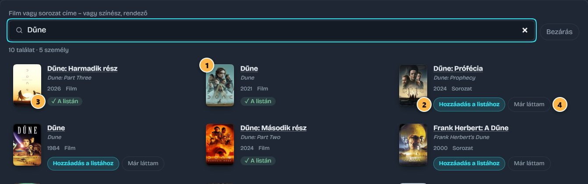

**Cím hozzáadása panel** (a fejléc gombja; telefonon a jobb alsó sarokban lévő kerek **+**):
- Kezdd el gépelni a címet (pl. „Dűne”) – egy pillanat, és ott vannak a TMDB találatai borítóval,
  évvel, típussal. ② **Hozzáadás a listához**, és kész. ③ Ami már a listádon van, azt a „✓ A
  listán” jelzi.
- **Színészre, rendezőre is kereshetsz** (pl. „Tom Hanks”): a **Színészek és rendezők** csoportban
  legfeljebb hat ember jön, kerek fotóval és azzal, amiről ismert („Színész · Forrest Gump, …”). Ha
  névre kerestél, ők állnak elöl. Egy névre kattintva a lapja nyílik (lásd
  [5.](#5-egy-cím-adatlapja-és-szerkesztése)) – a filmjeivel, és ott rögtön követni is tudod.
- ④ **Már láttam:** ha egy filmet már megnéztél, és csak a nyilvántartásba vennéd, ezzel
  **megnézettként** kerül fel (a mai nappal); sorozatnál a már megjelent évadok megnézettek lesznek.
  Rögtön alul ott a „Hogy tetszett?” sáv is (lásd [6.](#6-állapotok-letöltve-értékelések)). Ugyanez a
  gomb ott van az adatlap előnézetén és a színész lapján is.
- ① **Előbb megnéznéd?** Kattints a találat **borítójára vagy címére**: megnyílik a cím
  **adatlapja**, pont olyan, mint a listán lévőké – háttérkép, nagy borító, év, IMDb-érték, „Hol
  nézhető?”, előzetes, leírás, Hasonló címek –, csak éppen **listára vétel nélkül**. Az állapot, a
  franchise és a csillagok helyén gombok várnak: **Hozzáadás a listához** és **Már láttam**. Ha
  rákattintasz, a cím felkerül, az ablak pedig nyitva marad, és helyben rendes adatlappá válik („✓
  Felkerült a listádra”) – rögtön beállíthatod az állapotát, az értékelését. Ha mégsem kell: **Bezárás** / Esc /
  kikattintás. A már listán lévő találat borítója a saját, szerkeszthető adatlapját nyitja.
- Felvételkor a cím mindent megkap, amire szükség van: magyar címet és leírást (ha nincs magyar,
  angolt), műfajokat, borítót, háttérképet, IMDb-értékelést, sorozatnál az évadokat, filmnél a
  megjelenési dátumokat. Neked semmit nem kell kitöltened.

**Felfedezés – ha nem tudod, mit keress:** amíg a keresőmező üres, a panel ajánl.

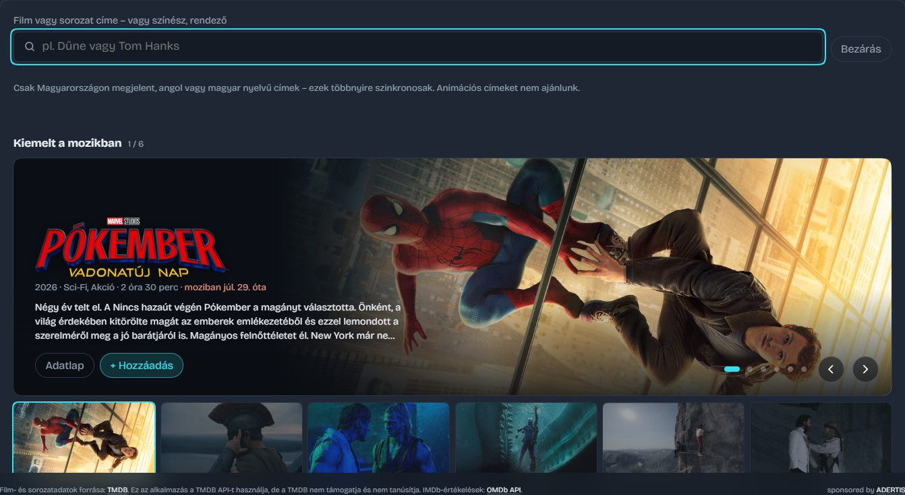

**Kiemelt a mozikban** – legfelül egy nagy sáv a mozikban épp futó filmek közül hat címmel, egyenként:
széles jelenetkép, a film logója (ha nincs, a címe), év · műfajok · játékidő · „moziban júl. 29. óta”,
a leírás eleje, és két gomb: **Adatlap** (megnézed, mielőtt felveszed) és **+ Hozzáadás** (ami már a
listádon van, annál „✓ A listán”). Lapozni a **‹ / ›** nyíllal, a pöttyökkel vagy az alattuk lévő kis
képekkel lehet – telefonon ujjal húzva. Magától nem lapoz, nyugodtan elolvashatod. Ha egy kiemelt film
nem érdekel, a **×**-szel elrejtheted (lásd lent), és a helyére a következő lép.

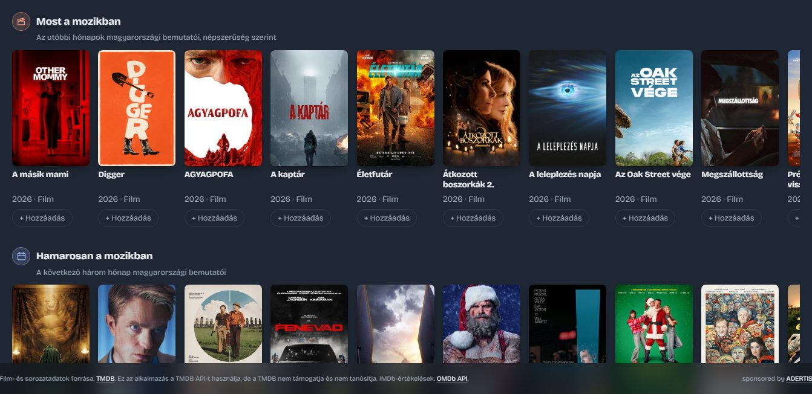

Alatta vízszintes borítósorok: *Most a mozikban* (a fent kiemeltek nélkül, hogy ne lásd kétszer),
*Hamarosan a mozikban* (dátummal), *Új digitálisan*, *Népszerű sorozatok* – mindegyik saját színű
ikonnal (mozi korall, hamarosan indigó, digitális égkék, sorozat zsálya). Egy kattintás („+
Hozzáadás”), és a listádon van; a **borítóra** kattintva előbb az adatlapját is megnézheted (mint a
találatoknál). Ami már a listádon van, az ide (és a kiemelt sávba) be sem kerül – csak az újdonságok
jönnek; amit most veszel fel, az „✓ A listán” jelzéssel a helyén marad. Csak olyan címeket mutat, amelyek valószínűleg **magyar szinkronnal** is elérhetők:
Magyarországon megjelent (sorozatnál magyar streamingen fut), angol vagy magyar nyelvű, van magyar
leírása, és nem dokumentum-, valóság- vagy talkshow. **Animációs** címet az ajánlások (a Felfedezés,
a kiemelt sáv, a Neked ajánlott és a Hasonló címek) nem kínálnak – keresni persze továbbra is
lehet rájuk.

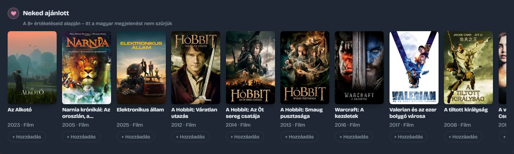

**Neked ajánlott** – az utolsó sor csak rólad szól: azokhoz a címekhez keres hasonlókat, amelyeket
legalább **8 csillagra** értékeltél (a legjobbakhoz, azon belül a legutóbb látottakhoz). Elöl az áll,
amit több kedvencedhez is ajánl a TMDB – az nagy eséllyel betalál. Ami már a listádon van, kimarad. Itt
a magyar megjelenést nem szűri (az alcím is jelzi). Ha még nincs 8+ értékelésed, ez a sor nem látszik.

**Nem érdekel:** ha egy ajánlott cím hidegen hagy, mutass a borítójára – a jobb felső sarkában
megjelenik egy **×** (telefonon mindig látszik). Rákattintva eltűnik, és többé sem a Felfedezés, sem a
Hasonló címek nem ajánlja (a keresésben azért továbbra is megtalálod). Fölötte 10 másodpercig ott a
„„…” elrejtve – többé nem ajánljuk. **Visszavonás**”, ha csak elkattintottad. Később meggondoltad
magad? A Felfedezés alján az **Elrejtett ajánlások (N)** alatt minden rejtett cím mellett ott a
**Mégis érdekel**.

**Hasonló címek** – minden adatlap alján (lásd [5.](#5-egy-cím-adatlapja-és-szerkesztése)),
„+ Hozzáadás” gombbal; a borítójukra kattintva az adatlapjuk ugyanabban az ablakban nyílik. A **×**
itt is működik (a „Visszavonás” a Hasonló címek tetején jelenik meg).

**Franchise-javaslat felvételkor:** ha olyan filmet veszel fel, ami egy franchise-od TMDB-gyűjteményébe
tartozik (mondjuk a Mátrix második részét, és van „Mátrix” franchise-od), pár másodperc múlva alul
megkérdezi: „„…” – a Mátrix franchise-ba tartozik?” → **Hozzárendelés**. Magától soha nem rendeli
hozzá, csak felajánlja. Ha egyszerre több ilyen film kerül fel (pl. tömeges importtal), egy sávban
szól („N új film egy franchise-odba tartozik” → **Megnézés**), és a Franchise-ok ablakban egyben
elintézheted őket (lásd [9.](#9-franchise-ok-és-gyűjtemények)).

**Toplisták – a legjobbak, egy helyen** (⋮ menü → **Toplisták**):

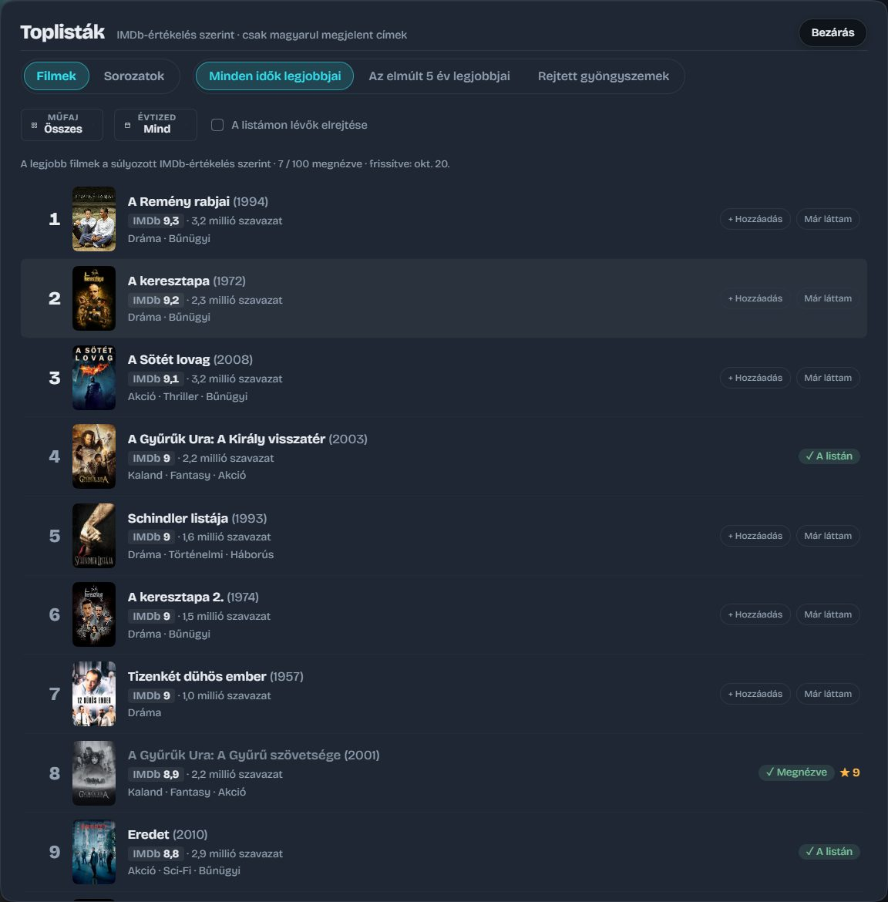

- A legjobb **filmek** vagy **sorozatok** a súlyozott IMDb-értékelés szerint – csak olyanok, amelyek
  magyarul is megjelentek (itthon moziba / digitálisan kerültek, sorozatnál magyar streamingen
  futnak). Az animáció benne van; a dokumentum- és valóságműsor nincs.
- Három lista: **Minden idők legjobbjai**, **Az elmúlt 5 év legjobbjai** és **Rejtett
  gyöngyszemek** (kevésbé ismert, de 7,5 fölötti címek). Mindegyikből a legjobb 100, 25-ösével
  (**Továbbiak mutatása**).
- Szűrők: **Műfaj** és **Évtized** (szűrve a helyezés is 1-től számol – „a legjobb krimik”), és **A
  listámon lévők elrejtése**.
- A lista leírása mellett ott a mérleged is: „· **7 / 100 megnézve**” – hányat láttál már belőle
  (szűrve a szűrt listából számol).
- Soronként helyezés, borító, cím, IMDb-érték, szavazatszám, műfajok; jobbra **+ Hozzáadás** és
  **Már láttam**, vagy ha már nálad van: „✓ A listán” / „✓ Megnézve” a csillagaiddal. A borítóra
  kattintva az adatlap-előnézet nyílik az ablak fölött.
- Az ablak megjegyzi, melyik listát nézted utoljára. A listák hetente frissülnek; az első
  összeállítás fél percig is eltarthat. Net nélkül a menüpont nem látszik.

**Tömeges import – ha sok címed van egyszerre** (⋮ menü, csak széles képernyőn):
1. Írd be soronként egy címet, legfeljebb 150-et. Ha a sor végére évszámot írsz, pontosabb lesz a
   találat (pl. „Dűne 2021” vagy „A sötét lovag (2008)”); az ismétlődő sorok csak egyszer
   számítanak.
2. **Keresés** – a biztos (pontosan egyező) találatok előre ki vannak jelölve. Ahol az app nem biztos
   a dolgában, borítós választót kapsz („Másik találat”), alapból „Kihagyás”. Ami már a listádon van,
   az kimarad.
3. **„N cím felvétele”** – ha valamelyik nem sikerült, a sora a szövegmezőben marad, újrapróbálhatod.

**Egy franchise hiányzó részei** – a gyűjtemény ablakából egy kattintással (lásd
[9.](#9-franchise-ok-és-gyűjtemények)).

## 5. Egy cím adatlapja és szerkesztése

**Megnyitás:** kattints a borítóra (kártyán és listasorban is), vagy a kártya bal felső sarkában a
ceruzára. Asztalon a borító szépen „átsiklik” az ablakba. A még nem listán lévő címek adatlapja a
Cím hozzáadása találataiból és a Felfedezésből nyílik (lásd [4.](#4-címek-felvétele)).

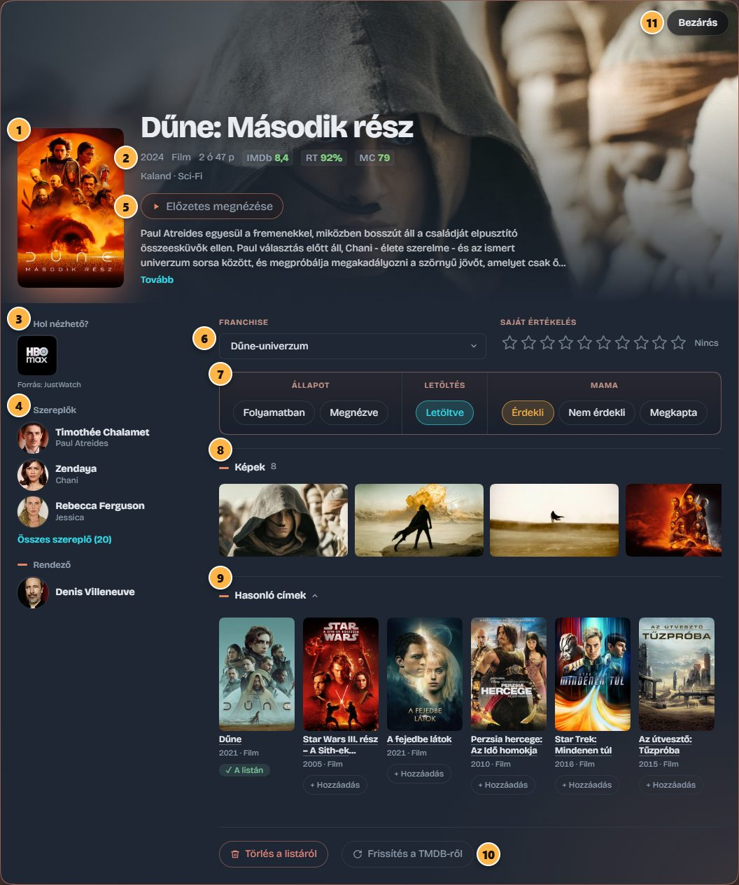

**Mit találsz az adatlapon:**
- ① **Moziszerű fejléc** (asztalon, ha a filmnek van jelenetképe): a kép az ablak felső részét
  kitölti, rajta balra lent a borító, mellette nagy betűkkel a cím, az adatsor, a műfajok, a leírás
  első három sora (alatta **Tovább**, ha hosszabb – kinyitva a kép és a cím a helyén marad) és az
  előzetes gombja. Az egész ablak halványan a borító színében dereng. Jelenetkép nélkül (és telefonon)
  balra a nagy borító, ill. telefonon a kép aljára úszó kis borító mellett a cím;
- ② az **adatsor**: év · Film / Sorozat · játékidő („2 ó 47 p”) · IMDb · RT · MC. Sorozatnál a
  játékidő helyett a legutóbbi rész hossza („~56 p / rész”), előtte pedig szavakkal, hol tart a
  sorozat: „Folytatódik · eddig 2 évad”, „Befejeződött · 5 évad”, „Elkaszálták az 1. évad után” vagy
  „Készül”. Az RT (Rotten Tomatoes – „92%”: ennyi kritikus ajánlja) és az MC (Metacritic – a
  kritikusok pontszámainak átlaga, 100-ból) csak ott áll, ahol van ilyen adat; mindhárom szám a
  skála színével (lásd [12.](#12-imdb));
- ③ **Hol nézhető?** – a magyarországi streamingszolgáltatók logói, ahol a cím előfizetéssel
  (Netflix, HBO Max, Disney Plus, SkyShowtime…) vagy ingyen nézhető; asztalon a bal oszlopban,
  keskenyebben az „Előzetes megnézése” fölött. A logóra mutatva kiírja a szolgáltató nevét.
  Kölcsönzés és vásárlás nem szerepel, és ha sehol nem nézhető, a blokk meg sem jelenik. Az adatok a
  JustWatch-tól jönnek (a TMDB-n keresztül, naponta frissülnek);
- ④ **Szereplők:** az első három szereplő, alattuk **Összes szereplő (N)** – kibontva akár húsz is
  (**Kevesebb** visszacsukja). Széles képernyőn a bal oszlopban, kerek fotóval és a szerep nevével;
  keskenyebben a leírás alatt egy sorban. Filmnél alatta a **Rendező** is. A **névre** kattintva a
  színész (rendező) lapja nyílik, az ablakon belül (lásd lent). (A szerepnevek a TMDB-ről jönnek,
  gyakran angolul.)
- ⑤ **Előzetes megnézése** (ha van; angol előzetesnél ott a jelzés: „angolul”) – az ablakon belül
  játssza le, az **Előzetes bezárása** gombbal pedig eltünteted;
- ⑥ egymás mellett a **Franchise** és a **Saját értékelés** (10 csillag), ⑦ alattuk egy keretes
  sávban, asztalon egy sorban az **Állapot** (Folyamatban / Megnézve), a **Letöltés** (egyetlen
  **Letöltve** gomb – újra kattintva kikapcsol) és a **Mama** (Érdekli / Nem érdekli / Megkapta –
  csak franchise nélküli filmnél, lásd [10.](#10-mama-jelölések)). Mindhárom gombsor ugyanúgy
  működik: a kiválasztottra újra kattintva üres lesz. Telefonon a sávban fent az Állapot, alatta a
  Letöltés és a Mama; keskenyebb ablakban a Franchise és a csillagok egymás alatt;
- sorozatnál az állapot helyett az **évadok** (lásd [7.](#7-sorozatok-és-évadok));
- ⑧ **Képek:** a film további jelenetképei (legfeljebb 8) egy vízszintes sorban; rákattintva **nagy
  nézetben** nyílnak – **‹ ›** gombbal, a nyilakkal vagy ujjal húzva lapozol, alul a kis képek, **×
  Bezárás** / Esc / Vissza gomb zárja. Telefonon a fejléc képe maga lapozható (jobbra fent „‹ 1 / 8
  ›”, alul pöttyök), koppintva nagy nézet;
- ⑨ alul **Hasonló címek**: a TMDB ajánlásai egy vízszintes sorban, „+ Hozzáadás” / „✓ A listán”. A
  **borítóra** kattintva a hasonló cím adatlapja nyílik **ugyanebben az ablakban** (ha még nincs a
  listádon, előnézetként, „Hozzáadás a listához” gombbal); a cím fölötti **„‹ Vissza: …”** visz
  vissza az előzőre – akár több lépésen át is, mint egy kis böngészőben. A hasonló cím **nevére**
  kattintva a TMDB-oldala nyílik új lapon. A sor becsukható, és a böngésző megjegyzi (telefonon mindig
  csukva indul). Csak a 2000-es vagy újabb, a TMDB-n legalább 6,0-ra értékelt (és legalább 50
  szavazatot kapott) címeket ajánlja – a régi vagy gyenge filmek kimaradnak;
- ⑩ a lap alján két kis ikonos gomb: **Törlés a listáról** (lásd lent) és **Frissítés a TMDB-ről** –
  ha egy cím adatai elavultak (pl. azóta lett magyar címe, leírása), egy kattintással frissíted. Utána
  pár másodpercig „✓ Frissítve” vagy „✓ Nincs újdonság a TMDB-n”. (Ezt az app havonta magától is
  megteszi.)
- ⑪ **Bezárás** – jobbra fent, görgetés közben is ott marad (lásd lent).

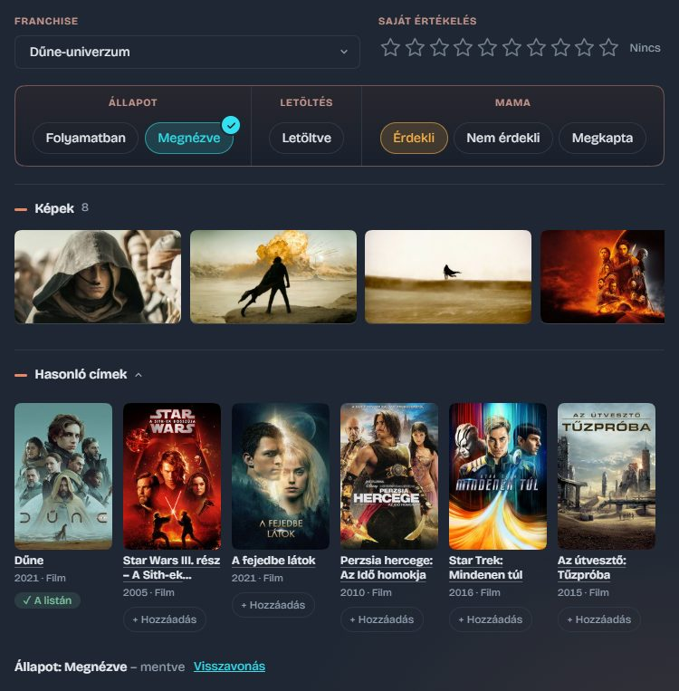

**Minden azonnal mentődik:** nincs Mentés gomb – amire kattintasz (állapot, letöltve, csillagok,
franchise, Mama), az rögtön elmentődik. A módosított gombon 2 másodpercig kis türkiz pipa jelzi, alul
pedig ott áll, mit mentett: „Állapot: Megnézve – mentve · **Visszavonás**”. A Visszavonás lépésenként
visszafelé dolgozik (10 másodpercig), így ha többet is elkattintottál, mindet visszacsinálhatod.

**A színész lapja:** a Szereplők egy nevére kattintva az ablakon belül megnyílik a színész lapja („‹
Vissza” visz vissza a filmhez): fotó, születési adatok, életrajz (magyarul, ha van; különben angolul –
ezt jelzi is: „Életrajz · angolul”), **A listádon** – a nálad lévő filmjei és sorozatai borítórácsban
(a megnézettek szürkén, a saját csillagaiddal) –, alatta **További filmjei és sorozatai** az ismertség
szerint, mindegyik mellett „+ Hozzáadás” és **Már láttam**. Itt választhatsz: **Főszerepek** (alapból
– a stáblista első három helye, sorozatnál legalább hat részben) vagy **Összes szerep**. A még meg nem
jelentek „Hamarosan” jelölést kapnak. A borítókra kattintva újabb adatlap nyílik, ugyanígy, egymás
mögött. Az animációk és a vendégszereplések kimaradnak. A **Rendező** nevére kattintva ugyanígy a
rendező lapja nyílik, a rendezett filmjeivel.

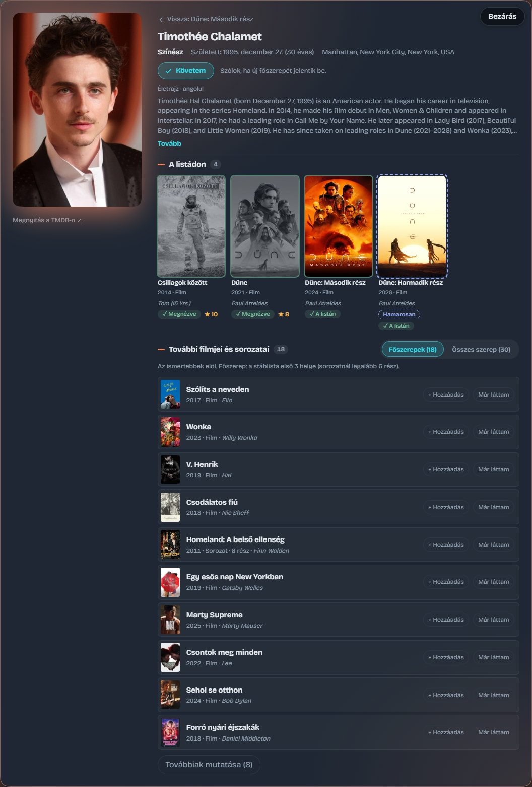

**Követem:** a név alatti **Követem** gombbal követheted a színészt vagy a rendezőt. Ettől kezdve
„Szólok, ha új főszerepét jelentik be” (rendezőnél: „új filmjét”) – a harangban jön az értesítés
(lásd [11.](#11-értesítések)). Újra kattintva leállítod a követést.

**Színészek és rendezők** (⋮ menü) – akiket követsz, egy ablakban:

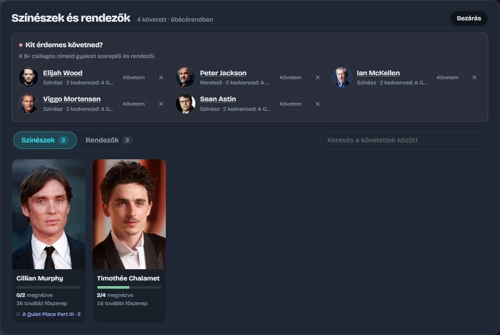

- **Kit érdemes követned?** – fölül legfeljebb hat javaslat: azok a színészek és rendezők, akik a 8+
  csillagos címeid közül legalább kettőben szerepelnek („Színész · 2 kedvenced: …”). **Követem**, és
  már lent is van; a **×**-szel a javaslat végleg eltűnik. Ha nincs mit javasolni, ez a rész nem
  látszik.
- Alatta két fül: **Színészek** és **Rendezők**, a darabszámmal, mellettük kereső (**Keresés a
  követettek között**).
- Csempénként ábécérendben: fotó, név, mérő és „2/4 megnézve · 16 további főszerep” – a listádon
  lévő filmjeiből mennyit láttál, és hány további (már megjelent) főszerepe van. Ha bejelentették a
  következő filmjét, indigóval az is ott áll, dátummal.
- **A csempére kattintva** az ablakon belül az idővonala nyílik: **Filmjei megjelenés szerint**,
  fölül a **Hamarosan** jövő filmekkel, alatta évenként. Soronként borító (rákattintva az adatlap),
  szerep, „+ Hozzáadás” / **Már láttam**. Innen is leállíthatod a követést (a lap nyitva marad, ha
  meggondolnád magad). Esc vagy Vissza: vissza a csempékhez.

**Bezárás** – minden ablak ugyanúgy működik:
- **Asztalon** jobbra fent a **Bezárás** gomb (görgetés közben is ott marad), az **Esc**, vagy elég
  az ablak mellé kattintani.
- **Telefonon** minden ablak alulról felcsúszó lap: a tetején lévő fogantyút lefelé húzva bezárul
  (a háttérre koppintás ott nem zár).
- Nem zárul be, ha épp valamit szerkesztesz vagy megerősítenél (pl. a törlést, a Franchise mezőben új
  nevet gépelsz, egy cím épp felkerül) – ilyenkor az ablak megbillen, a lap visszaugrik, nehogy
  elvesszen, amit csinálsz. Akkor sem zár, ha szöveget jelölsz ki, és az egér az ablakon kívül áll
  meg.
- **Vissza gomb** (telefonon a vissza-gesztus is): ha több lap van egymás mögött (pl. film → színész →
  másik film), egyesével lép vissza, a végén bezárja az ablakot – nem lép ki az appból.

**Törlés az adatlapról:** **Törlés a listáról** → „Biztosan törlöd a listádról?” → **Törlés** → a
cím lekerül, és alul 8 másodpercig ott a **Visszavonás**, ha mégis meggondolnád magad.

**Szerkesztés közvetlenül a listasorban** (lista nézet): Letöltve pipa, Állapot és Mama lenyíló (a
Mama-cella franchise-os címnél és sorozatnál üres), csillagok, franchise lenyíló (üresen csak akkor
látszik, ha a sorra mutatsz), a sor végén kuka.
Minden **azonnal mentődik**; ha valami hiba van, visszaáll az előző érték. A **kukával** megerősítés
nélkül lekerül a cím – 8 másodpercig **Visszavonás**. Véglegesen csak ezután törlődik (ha közben
bezárod az oldalt, a cím megmarad).

## 6. Állapotok, letöltve, értékelések

**Állapotok – hol tartasz egy címmel:**
- **Megnézendő** – az alapállapot. Ezért szándékosan **nem jelenik meg** felirat vagy szín a soron /
  kártyán (csak a szűrő nevezi meg) – így a lista nincs teleírva ugyanazzal a szóval.
- **Folyamatban** – türkiz.
- **Megnézve** – zöld; a cím **háttérbe húzódik**: fekete-fehér, fakó borító, tompított szöveg
  (rámutatva újra teljes színű). És egy kis jutalom: amikor egy címet (vagy a nézési sorrendben egy
  évadot) Megnézve-re állítasz, egy zöld vonal fut végig a címén – „kihúzod a listádról” –, majd
  elhalványul (a nézési sorrend ablakában a vonal ott marad). Ha a gépen be van kapcsolva a
  „kevesebb mozgás”, nincs animáció.
- **Abbahagyva** – halvány lila, csak sorozatnál (lásd [7.](#7-sorozatok-és-évadok)); ez is háttérbe
  húzódik.
- Az adatlapon a kiválasztott állapotra újra kattintva visszaáll Megnézendőre.
- **A megnézés napja:** amikor egy címet Megnézve-re állítasz, az app a háttérben megjegyzi a napot
  (nem látszik, nem kell beírni). A Statisztika havi kimutatása és a CSV-mentés ebből dolgozik; a
  korábban importált, dátum nélküli megnézett címek ezekben nem szerepelnek.

**Letöltve:** a listasorban egy pipa, az adatlapon egy **Letöltve** gomb (újra kattintva
kikapcsol). Amikor egy cím **Megnézve** lesz, a jelölés magától lekerül – hiszen már nem kell a gépen
tartanod. (Ha utána mégis újra bejelölöd, megmarad.)

**Saját értékelés:** 1–10 csillag, borostyánszínnel. Ugyanarra a csillagra újra kattintva (vagy az
adatlapon a „Törlés” linkkel) törlődik. Billentyűzettel a nyilak csak mutatják, hová kerülne, és az
**Enter** (vagy a Szóköz) menti.

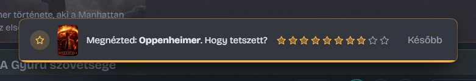

**„Hogy tetszett?”** – ha a listában Megnézve-re állítasz egy még nem értékelt címet (vagy a **Már
láttam** gombbal veszed fel), alul felbukkan egy borostyánszínű sáv csillagsorral: egy kattintás, és
már értékelted is. Ha most nincs kedved hozzá: **Később**. (Az alsó sávok fajtájuk szerint színesek:
a törlésé piros, kuka ikonnal, a „Hogy tetszett?” borostyán, csillaggal, a többi türkiz.)

**IMDb-, Rotten Tomatoes- és Metacritic-értékelés:** „IMDb 8,0”, „RT 92%”, „MC 79” jelvény, a szám
a skála színével (rámutatva a magyarázat) – lásd [12.](#12-imdb).

## 7. Sorozatok és évadok

Sorozatoknál nem kell egyben gondolkodnod: minden évadot külön követhetsz.

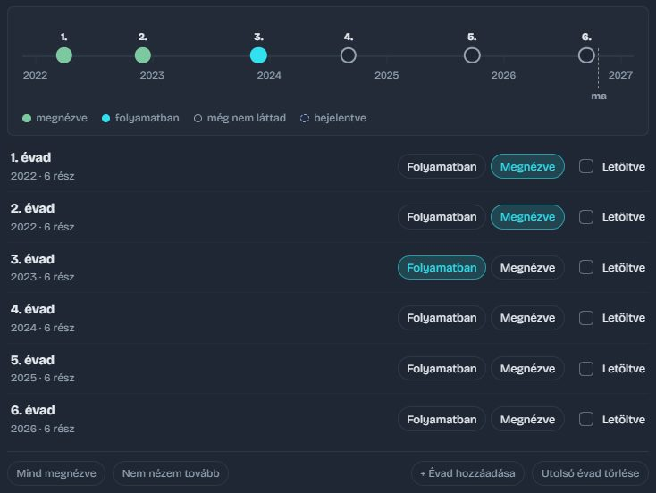

**Évadok az adatlapon:** évadonként saját állapot (Folyamatban / Megnézve) és **Letöltve** pipa.
Alattuk a gombok: **Mind megnézve**, **Nem nézem tovább** / **Mégis folytatom**, **+ Évad
hozzáadása**, **Utolsó évad törlése** (megerősítéssel). Az évadok változása – mint az adatlapon
minden – **azonnal mentődik**.

- Ha egy évadot megnézettre állítasz, az előtte lévő üres évadok is megnézettek lesznek (ha a 3.-at
  láttad, az 1–2.-at nyilván már igen) – 10 másodpercig ott a **Visszavonás**, ha mégsem így volt.
- **A sorozat állapota az évadokból számolódik, magától:** minden megjelent évad megnézve →
  Megnézve; van megkezdett vagy megnézett évad → Folyamatban; különben Megnézendő. Letöltve = van
  letöltött évad.
- A **bejelentett** (jövőbeli vagy dátum nélküli) évad indigó, szaggatott, nem jelölhető, és nem
  számít bele a „mind megnézve” feltételbe. (Az indigó szaggatott mindenhol ugyanezt jelenti: még meg
  nem jelent évad vagy rész – az évadcsíkon, az idővonalon, a nézési sorrendben és a gyűjteményben
  is.)
- **Abbahagyva** („Nem nézem tovább”): ha egy sorozatot feladtál, a listán marad, de háttérbe
  húzódik; az adatlapon az évadlista tetején lila sáv jelzi. Új évad sem írja felül. A „Mind
  megnézve” feloldja (Megnézve lesz), a „Mégis folytatom” után pedig újra az évadokból számolódik.
- Ha törölsz egy évadot, ami a TMDB-n szerepel, a heti frissítés üresen visszahozza.

**Évadok idővonala** (az adatlapon, legalább 2 évadnál – a fenti kép teteje): évadonként egy pötty a
megjelenés napján, az állapot színével; a bejelentett szaggatott, a „ma” jelölve. Egy pillantás, és
látod, hol tartasz, és mi jön még. A pöttyre kattintva a lista az adott évadhoz görget.

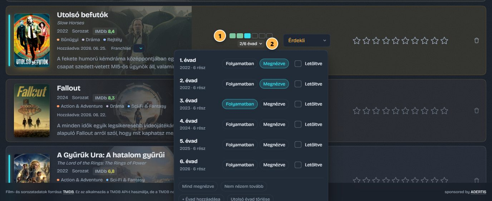

**A listában:** ① az Állapot cellában évadcsík (évadonként egy szakasz); egy szakaszra kattintva
lép: üres → Folyamatban → Megnézve → üres. ② Az „x/y évad” feliratra kattintva lenyíló panel nyílik
az évadokkal – ugyanazok a gombok, mint az adatlapon. A Letöltve cellában a letöltött évadok számai.
**A kártyán:** a borító alján az évadcsík és az „x/y évad”.

**Új évadok maguktól:** az app hetente megnézi a TMDB-n a sorozataidat; az új (megjelent vagy
bejelentett) évad magától felkerül, és a harang szól róla (lásd [11.](#11-értesítések)). A
bejelentett évadot a sorozat is mutatja: a kártya borítóján indigó jelvény („3. évad · dec. 8.”,
más évben „3. évad · 2027. márc. 5.”, dátum nélkül „3. évad · hamarosan”; telefonon csak a dátum),
a lista nézetben az Állapot cellában, az „x/y évad” alatt. Abbahagyott sorozaton nincs ilyen jelvény.
Epizódszintű követés nincs.

**Hol tart a sorozat?** Az adatlap adatsorában szavakkal: „Folytatódik · eddig 2 évad”,
„Befejeződött · 5 évad”, „Elkaszálták az 1. évad után” vagy „Készül”, mellette a legutóbbi rész
hossza (lásd [5.](#5-egy-cím-adatlapja-és-szerkesztése)). Ez is hetente frissül.

## 8. Még meg nem jelent filmek

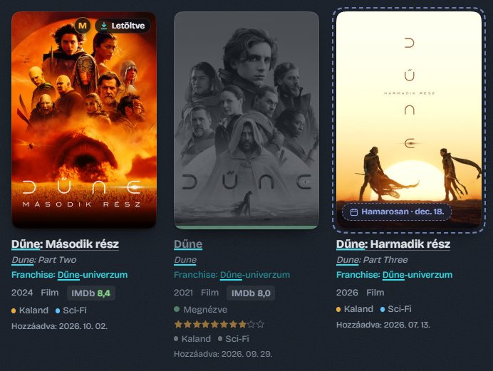

Olyan filmet is felvehetsz, ami még meg sem jelent – az app figyel helyetted. A listán ezek
**szaggatott kerettel** válnak ki, és **dátumos jelvényt** kapnak (kártyán, listasorban, adatlapon):
- **„Hamarosan · dec. 18.”** (indigó) – még a moziba sem került (vagy csak digitálisan jön); ha csak
  az éve ismert: „Hamarosan · 2027”.
- **„Moziban · digitálisan: okt. 29.”** (korall) – moziban fut, letölteni még nem lehet; ha még nincs
  ismert dátum: „digitálisan: még nincs dátum”. A borító szaggatott kerete is ilyen színű.
- Telefonon a kártyán csak a dátum („dec. 18.”) vagy a „Moziban” látszik.
- Amint a film digitálisan megjelent, a keret és a jelvény eltűnik, és a **harang szól**:
  „Digitálisan is megjelent – már letölthető”.
- A dátumokat az app a háttérben, 3 naponta frissíti a TMDB-ről (előbb a magyarországi, ha az nincs,
  az amerikai megjelenést nézi). A megnézett filmeknél nincs jelölés.

## 9. Franchise-ok és gyűjtemények

A franchise a saját „dobozod” az összetartozó címeknek – Gyűrűk Ura, Marvel, Mátrix, ami csak
eszedbe jut. Az app ehhez a TMDB gyűjteményeit is segítségül hívja, így azt is látod, mi hiányzik
még.

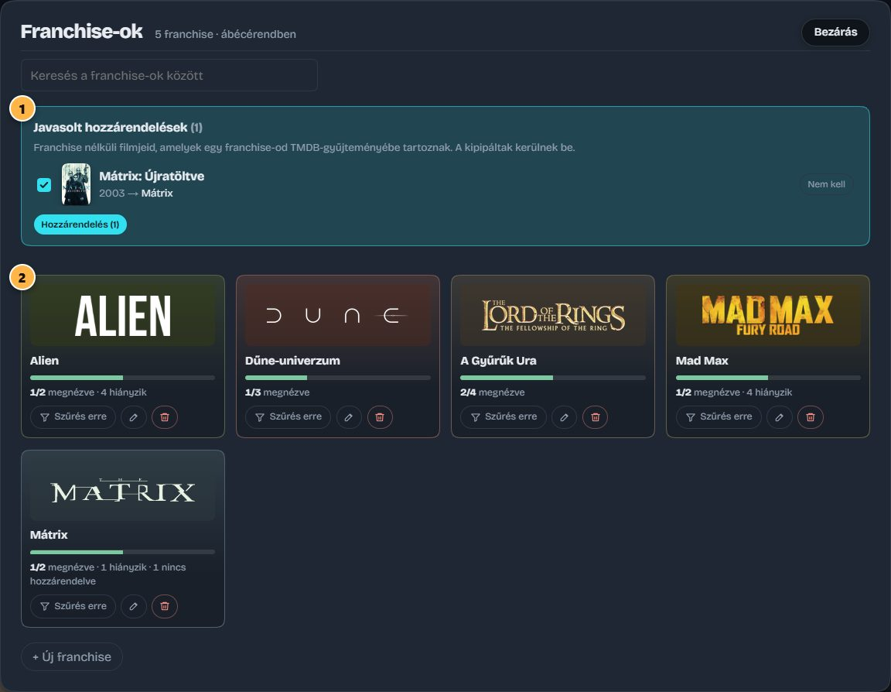

**Franchise-ok áttekintése** (⋮ menü → **Franchise-ok**, telefonon is): az összes franchise-od egy
ablakban, **ábécérendben** (a névelő – „A”, „Az”, „The” – nem számít: „A majmok bolygója” az M-nél
van).

① **Javasolt hozzárendelések** – fölül (ha van mit javasolni): a franchise nélküli filmjeid, amelyek
egy franchise-od TMDB-gyűjteményébe tartoznak, mellettük, hová kerülnének („2003 → Mátrix”). Alapból
mind ki van pipálva; amelyik nem kell, abból vedd ki a pipát, aztán **Hozzárendelés (N)**. Ha egy
javaslatot soha többé nem akarsz látni, a sor végén **Nem kell**. Ha nincs javaslat, ez a rész nem
látszik. A meglévő franchise-jelölésekhez nem nyúl.

② Csempénként:
- a franchise **logója** (ha nincs, a neve) – a csempe halványan felveszi a franchise legjobb
  címének borítószínét –, alatta a név és egy mérő: a listádon lévő címeiből mennyit láttál már
  (zöld; a még hiányzó részek nem számítanak bele);
- a számok: „1/2 megnézve · 4 hiányzik” – az első két szám a mérőé (megnézve / a listádon), a
  hiányzókat a TMDB-gyűjteményekből számolja (első megnyitáskor pár másodperc, amíg betöltődnek,
  addig „…”); gyűjtemény nélkül „nincs TMDB-gyűjtemény”, üres franchise-nál „Még nincs címe”;
- **a csempére kattintva** a franchise gyűjtemény-ablaka nyílik (lásd lent) – bezárva visszakerülsz a
  Franchise-ok ablakba;
- **Szűrés erre** – bezárja az ablakot, és a listán ennek a franchise-nak **minden** címe látszik (a
  többi szűrő elenged, a megnézettek is);
- **Átnevezés** (ceruza ikon; helyben – Enter: mentés, Esc: mégse) és **Törlés** (kuka ikon;
  megerősítéssel – a címek a listán maradnak, csak a franchise-jelölésük kerül le). Ha egy csempe
  számai még töltődnek, rákattintva soron kívül betölti és rögtön megnyitja („· megnyitás…”).

Felül **kereső** (ékezet nélkül is talál), alul **„+ Új franchise”**: a név megadása után rögtön a
gyűjtemény-ablaka nyílik, ahol hozzárendelhetsz egy TMDB-gyűjteményt, és felveheted a részeit.

**Franchise beállítása egy címnél:** az adatlapon a Franchise mezőben, vagy a listasorban a
franchise lenyílóban. Lehetőségek:
- a meglévő franchise-aid;
- **„+ Új franchise…”** – helyben beírod a nevet (Enter: hozzáadás, Esc: mégse);
- **„✎ „Név” átnevezése…”** – helyben, a régi névvel kitöltve (Enter: mentés);
- **„× „Név” törlése…”** – megerősítés után minden címről lekerül.

**Franchise-szűrő logókkal:** a logót az app magától megkeresi a franchise első filmjéhez (a sötét
logókat fehérre színezi, hogy látszódjanak) – egy új franchise-nál rögtön, amint bekerül az első
címe (pár másodperc, újratöltés nélkül). Ha a TMDB-n nincs a filmhez logó, a név látszik, és az app
egy hét múlva újra próbálkozik (kézzel is választhatsz – lásd lent, **Logó választása**). A szűrő
listája két csoportban mutatja őket: fölül **Van még
megnézendő** (a név mellett „2 hátra”), alul halványan **Mind megnézve** – így rögtön látod, hol van
még dolgod.

**Franchise-ra szűrve minden látszik, sorban:** a típus „Filmek és sorozatok” lesz, az Állapot
„Mind” (a megnézettek is ott vannak, így látod az egészet), a rendezés pedig a franchise nézési
sorrendje, ha van ilyen (lásd lent), különben **Legrégebbi megjelenés**. Ha a franchise-szűrőt
megszünteted, az előző állapotszűrőd jön vissza (ha közben kézzel nem választottál másikat).

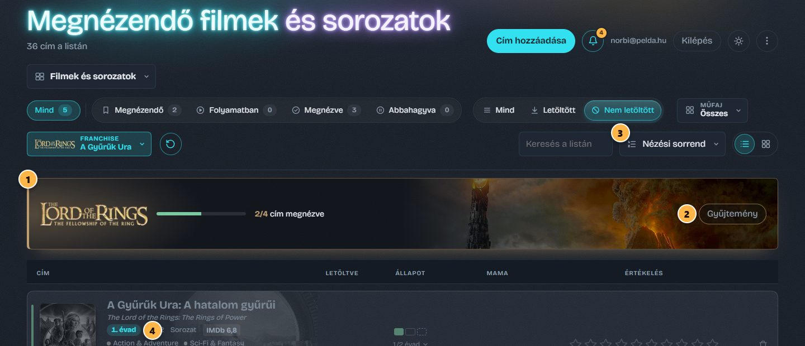

**Gyűjtemény sáv:** ① franchise-ra szűrve a lista fölött egy sáv jelenik meg: logó, mérő (a listádon
lévő címekből a megnézettek aránya, zölden) és „x/y cím megnézve · m hiányzik” (y a listádon lévők
száma, mint a mérőben; a „hiányzik” csak akkor, ha van még felvehető rész), a jobb
oldalán pedig a franchise legjobb értékelésű címének jelenetképe (ha annak nincs, a gyűjteményé). A
sáv a franchise saját színét kapja (a legjobb címének borítójából): színes keret, a bal szélén
pálca, a számok és a gomb is ebben a színben.
③ Ha a franchise-nak van saját nézési sorrendje, a rendezés magától **Nézési sorrend** lesz, ④ a
sorozatok pedig évadonként külön sorban jönnek („2. évad”) – lásd lent.

② A **Gyűjtemény** gomb ablakot nyit, két füllel – az egész ablak halványan a franchise színében
dereng. Az ablak fejlécében is a sáv jelenetképe látszik, mellette a franchise műveletei ikonos
gombokként: **Szűrés erre** (ha a Franchise-ok ablakból nyitottad), **Átnevezés** (helyben; Enter:
mentés, Esc: mégse), **Logó** és **Törlés** (megerősítéssel). Kikattintásra bezárul – akkor is, ha
épp a TMDB-gyűjtemény keresője van nyitva; ha a Franchise-ok ablakból nyitottad, kikattintva mindkét
ablak bezárul.

**Logó választása:** ha nem tetszik, amit az app talált, a **Logó** gombbal te döntesz. A panel a
franchise címeinek TMDB-logóit mutatja (mindegyik alatt, melyik címé), kattints arra, amelyik az egész
franchise-t jelölje – rögtön mentődik. Az első lehetőség a **Csak a név**: logó helyett a franchise
neve áll. **Kész** – vissza. A kézzel választott logót az app soha nem írja felül.

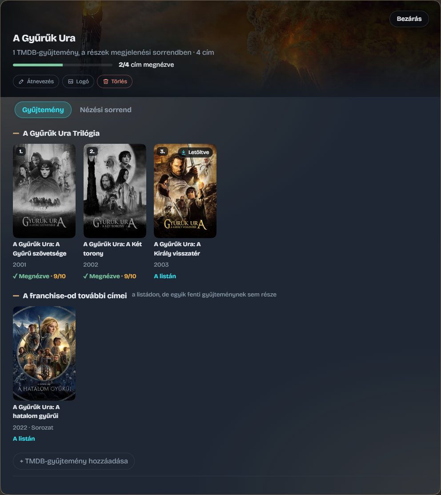

**Gyűjtemény fül:**
- szakaszonként a franchise filmjeinek **minden TMDB-gyűjteménye**, a részek megjelenési
  sorrendben, sorszámmal; a megnézettek szürkék a saját értékeléssel, a listán lévők „A listán”, a
  **hiányzók szaggatott kerettel, „+ Hozzáadás”** gombbal (a franchise-t is megkapják) – vagy
  egyszerre mind: **„A hiányzó N felvétele”**;
- ha egy rész **már a listádon van, de nem ebben a franchise-ban**, türkiz szaggatott keret jelzi:
  „A listádon, franchise nélkül” → **+ Hozzárendelés**, vagy „A listádon – „Másik franchise”” →
  **Áthelyezés ide**; a franchise nélkülieket alul egyben is: **„A listádon lévő N hozzárendelése”**.
  A számokban („· N hiányzik · N nincs hozzárendelve”) csak a franchise saját címei számítanak;
- **„A franchise-od további címei”**: ami egyik gyűjteményben sincs (pl. sorozatok);
- **„+ TMDB-gyűjtemény hozzáadása”**: ha az app magától nem találta meg, kézzel is hozzárendelhetsz
  egyet. Gépelés nélkül is ajánl: **Javasolt gyűjtemények** a franchise neve és a filmjei címe
  alapján. Vagy keress rá (magyarul gyakran nincs találat, angolul igen, pl. „Star Wars”) →
  **Hozzárendelés**; a kézzel hozzárendelt szakasznál **Eltávolítás**. A gyűjtemény nevére vagy
  borítójára kattintva a TMDB-oldala nyílik új lapon.

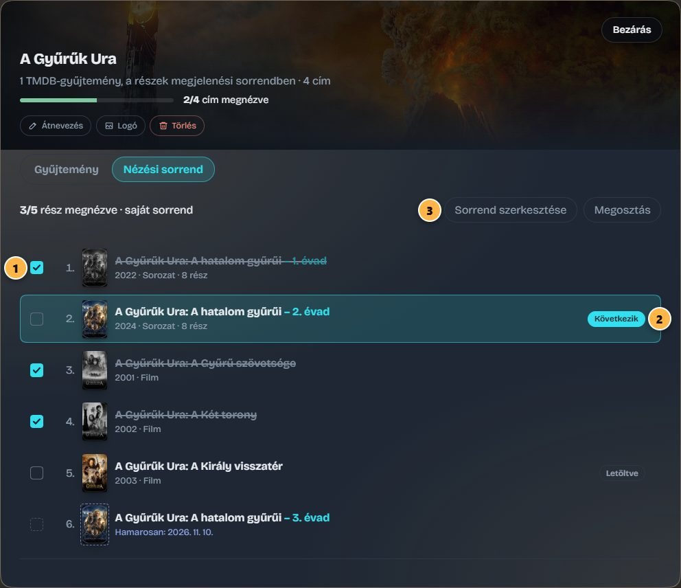

**Nézési sorrend fül** – ha nem a megjelenés sorrendjében akarod nézni (szia, Marvel!): a franchise
**listádon lévő** filmjei és a sorozatok **évadjai külön tételként** (pl. „A hatalom gyűrűi – 2.
évad”), számozott listában – így két évad közé egy film is beilleszthető. A TMDB-gyűjtemény hiányzó
részei itt nem szerepelnek.
- Amíg nem állítasz be saját sorrendet, **megjelenés szerint** áll; fent „x/y rész megnézve ·
  megjelenés szerint” (vagy „saját sorrend”).
- ① **Kipipálás:** a tétel előtti jelölőnégyzettel a filmet vagy az évadot megnézettre állítod
  (ugyanaz, mintha a listán vagy az adatlapon tennéd). A megnézett tétel **kihúzva, halványan a
  helyén marad**, ② az első még meg nem nézett pedig kiemelve: **Következik** – így mindig tudod, mi
  jön. A pipát újra kattintva visszaveheted. Évadnál – mint a listán – az előtte lévő, még üres
  évadok is megnézettek lesznek („1. évad is megnézve.” → **Visszavonás**). Ha a cím ettől megnézett
  lett, és még nincs értékelése, a tétel alatt rögtön megkérdezi: **„Hogy tetszett?”** (vagy
  **Később**).
- A **bejelentett**, még meg nem jelent évad nem pipálható; az **abbahagyott** sorozat meg nem nézett
  évadjai „Abbahagyva” jelöléssel a helyükön maradnak, a „Következik” átugorja őket.
- ③ **Sorrend szerkesztése:** a tételek a bal szélükön lévő fogantyúval **húzhatók** (egérrel vagy
  ujjal), vagy a **↑ / ↓** gombokkal léptethetők. **Kész** – mentés; **Mégse** (vagy Esc) – elveti;
  **Megjelenés szerint** + **Kész** – a saját sorrend törlődik, újra megjelenés szerint áll.
  Szerkesztés közben az ablak kikattintásra nem zárul be, nehogy elvesszen a munkád.
- **Új cím vagy évad** (pl. új évad érkezik, vagy egy filmet a franchise-hoz rendelsz) a sorrend
  **végére** kerül – onnan szerkesztéssel áthelyezheted. Ha egy címet másik franchise-ba teszel,
  kikerül a régi sorrendből.

**Nézési sorrend a listán:** ha a franchise-nak van saját sorrendje, a franchise kiválasztásakor a
**Rendezés** magától **Nézési sorrend** lesz (más rendezés is választható; másik franchise-nál vagy
franchise nélkül az előző rendezés jön vissza, és ez a lehetőség nem is látszik). Ilyenkor a lista a
sorrend tételeit mutatja: a **sorozat évadonként külön sorban / kártyán**, „2. évad” jelöléssel,
akár több helyen is. Az állapot- és a letöltés-szűrő tételenként számít – a **Megnézendő** szűrővel
pontosan a még meg nem nézett filmek és évadok látszanak, sorrendben. Kész a nézési terved!

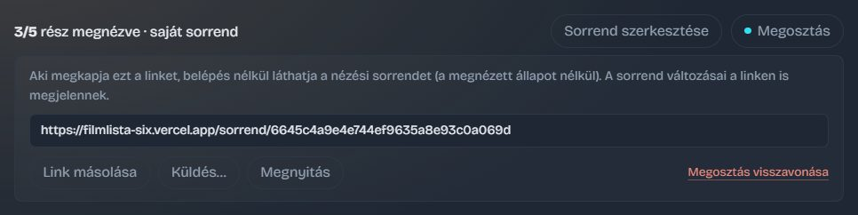

**Megosztás:** a Nézési sorrend fül sávjában a **Megosztás** gombbal egy linket kapsz, amit bárkinek
elküldhetsz – belépés nélkül megnézheti a franchise nézési sorrendjét (borítókkal, a franchise
színében), de azt nem, hogy mit láttál, mit hogyan értékeltél. **Link létrehozása** → **Link
másolása** („✓ Másolva”), **Küldés…** (ahol a gép tudja: a rendszer megosztója), **Megnyitás**. A
sorrend változásai a linken is azonnal látszanak. Élő linknél türkiz pötty a gombon. Ha már nem
akarod, hogy működjön: **Megosztás visszavonása** (megerősítéssel) – a link ezután „Ez a link már
nem érvényes” oldalt mutat; az újra létrehozott link más lesz.

**Új rész érkezett?** Ha egy franchise-od TMDB-gyűjteményébe új film kerül (amit még nem vettél fel,
és nem is rejtettél el), a harang szól: „Új rész a gyűjteményben – Dűne” (lásd
[11.](#11-értesítések)).

## 10. Mama-jelölések

Ha Mamának is gyűjtöd a jó filmeket, itt tarthatod számon, mi érdekli, és mit kapott már meg. A
legjobb az egészben: **Mama maga jelöli meg**, mi érdekli – a saját fiókjával, a saját oldalán (lásd
lent).

**A te oldaladon:**
- **Érdekli** / **Megkapta** – borostyánszínnel; **Nem érdekli** – tompa szürkével (ezt általában
  Mama jelöli). Az adatlapon gombként (újra kattintva törlődik), a listasorban lenyílóval.
- Csak **franchise nélküli filmeknél** van értelme (Mama oldala is csak ezeket kínálja): sorozatnál és
  franchise-os filmnél az adatlapon nincs Mama-csoport, a listasorban üres a cella (ha már volt
  jelölése, az megmarad, hogy törölhesd).
- **A kártyán** csak az „Érdekli” látszik: borostyánszínű **„M”** a borító jobb felső sarkában (a
  többit a szűrő mutatja).
- **Mama-szűrő** (Összes / Érdekli / Nem érdekli / Megkapta) – akkor jelenik meg, ha van legalább egy
  jelölés (Sorozatoknál és franchise-ra szűrve nem). Így pillanatok alatt összeszeded, mit vigyél neki
  legközelebb.
- Ha Mama valamire azt mondja, hogy „Érdekel”, **a harang szól**: „Mamát érdekli” (lásd
  [11.](#11-értesítések)).

**Mama oldala – „Norbi filmjei”:**

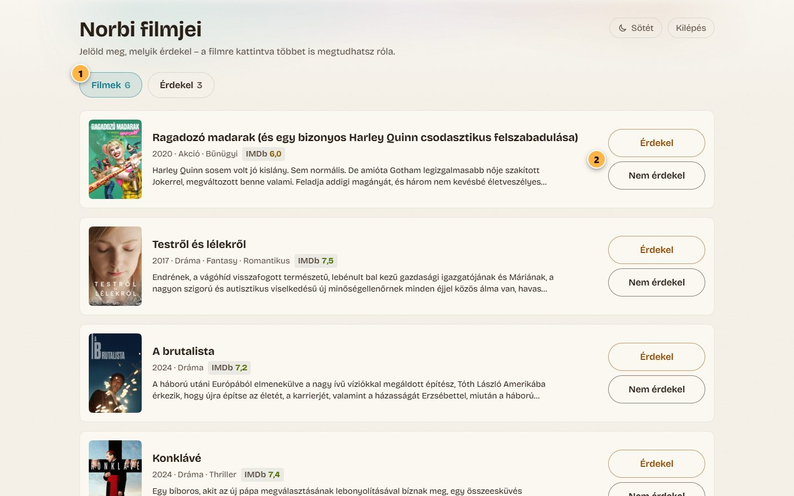

Mama a saját e-mail-címével és jelszavával lép be ugyanitt, és nem a te listádat látja, hanem egy
nagy betűs, egyszerű oldalt: **Norbi filmjei** – alapból világos témában (jobbra fent a **Sötét** /
**Világos** gombbal vált). Rendezés, kereső, menü, harang nincs – csak a filmek és két gomb:
- ① **Szűrő:** **Filmek** (alapból – amikről még nem döntött) és **Érdekel** (amiket bejelölt),
  mindkettő mellett a darabszám.
- A **Filmek** között a te **megnézendő, franchise nélküli, már megjelent filmjeid** vannak (a
  letöltöttek is), amelyeket még nem jelölt meg – a legutóbb hozzáadottak elöl, egyszerre **öt**,
  hogy ne legyen sok („További filmek” – még öt). Sorozatot, a saját értékelésedet és az állapotokat
  nem látja.
- ② **Érdekel** (borostyán) és **Nem érdekel**: a **Filmek** között mindkettő leveszi a sort, és a
  következő film lép a helyére; alul „„…” – érdekel.” / „– nem érdekel.” és **Visszavonás**, ha
  mellényúlt. Az **Érdekel** fülön a „✓ Érdekel”-re újra kattintva visszavonja (a sor a fül
  váltásáig a helyén marad).
- A borítóra vagy a címre kattintva **adatlap** nyílik: jelenetkép, borító, év, műfajok, a film
  hossza, IMDb, **Előzetes megnézése**, leírás, **Hol nézhető?**, alul a két nagy gomb – az ablak
  halványan a film színében dereng, mint a tiéd.
- Az „Érdekel” filmek addig maradnak nála, amíg te **Megkapta**-ra nem állítod őket.
- Ha nincs új film, ezt írja: „Most nincs új film, amiről kérdeznénk.”
- Ha legalább öt percig nem nézte, visszatéréskor magától frissül (a te újonnan felvett filmjeid is
  megjelennek); új app-változatnál ugyanaz a „Frissült az app” sáv szól, mint nálad.

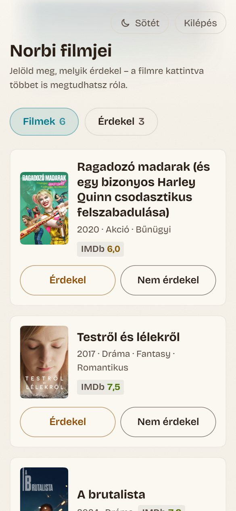

Telefonon a gombok a film alá kerülnek, az adatlap alulról csúszik fel (lehúzva bezárul). Mama
oldala net nélkül nem működik – ott nincs mentett lista.

## 11. Értesítések

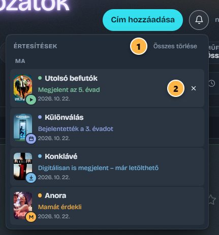

**Harang a fejlécben** – szól, ha valami történt a listádon. Az olvasatlan értesítések száma
borostyán jelvényben; ha nő a szám, a harang egyszer megrezzen. Kinyitva a legutóbbi 30, borítóval,
napok szerint csoportosítva (**Ma** / **Ezen a héten** / **Korábban**). Minden fajtának saját színe és
kis ikonja van a borító sarkán:
- „Bejelentették a 4. évadot – várható: dec. 18.” (indigó, naptár; ha még nincs dátum, csak az első
  fele)
- „Megjelent az 5. évad” (zöld, lejátszás)
- „Digitálisan is megjelent – már letölthető” (film; égkék, letöltés)
- „Mamát érdekli” – Mama az oldalán „Érdekel”-t jelölt egy filmre (borostyán „M”; lásd
  [10.](#10-mama-jelölések)) – élő szinkronnal pár másodpercen belül megjelenik
- „Új rész a gyűjteményben – Dűne” (+ „· várható: …”) – egy franchise-od TMDB-gyűjteményébe új film
  került (korall filmcsapó); a sorban a rész címe és borítója, kattintva az előnézete nyílik (lásd
  [9.](#9-franchise-ok-és-gyűjtemények))
- „Timothée Chalamet új filmje · várható: 2026. 12. 18.” – egy követett színésznek (rendezőnek)
  új főszerepét (filmjét) jelentették be; a borító sarkában a színész kerek fotója, kattintva a film
  előnézete nyílik (lásd [5.](#5-egy-cím-adatlapja-és-szerkesztése)). Az app hetente néz körül, és
  csak a dátummal bejelentett filmekről szól.

Kinyitáskor mind olvasottá válik. Egy értesítésre kattintva a cím adatlapja nyílik. Kívülre
kattintva vagy Esc-re bezárul.

**Rendrakás a harangban:** ② a sor végén lévő **×** törli az értesítést (egérrel akkor látszik, ha a
sorra mutatsz; telefonon mindig), ① a fejlécben az **Összes törlése** pedig az összes látható
értesítést. Mindkettő után alul ott a **Visszavonás**, ha elkattintottad. A törölt értesítés nem jön
vissza – kivéve, ha Mama egy filmre újra „Érdekel”-t mond.

**Értesítősáv alul középen:** rövid üzenetek, pl. „Visszavonás” a törlés után (piros, kuka ikonnal),
vagy a „Hogy tetszett?” (borostyán, csillaggal). 8 másodperc után eltűnik (a fogyó csík mutatja,
mennyi ideje van még); ha rámutatsz, megáll; a × gombbal azonnal bezárható.

## 12. IMDb

**IMDb-értékelés magától:** minden címnél „IMDb 8,0” jelvény; az app kéthetente frissíti. Rendezhetsz
is szerinte („Legjobb IMDb-értékelés”). Rámutatva: „IMDb-értékelés: 8,0 (123 456 szavazat)”.

**A kritikusok is szóhoz jutnak:** az IMDb mellett – ahol van ilyen adat – a **Rotten Tomatoes**
(„RT 92%”: a kritikusok 92%-a ajánlja) és a **Metacritic** („MC 79”: a kritikusok pontszámainak
átlaga, 100-ból). Sorozatoknál gyakran nincs, ilyenkor egyszerűen nem látszik. Az adatlapon és a
lista nézetben jelenik meg; a kártyán (és Mama oldalán) csak az IMDb. Mindhárom szám a skála színét
kapja: 40 alatt piros, 60 körül sárgás, 80-tól zöld, közte átmenettel. Az IMDb-vel együtt frissül, és
a Mentés letöltése CSV-jébe is bekerül.

**⋮ menü → IMDb import** – ha az IMDb-n is vezetted a dolgaidat, nem kell újra begépelned.
(Asztalon és tableten; telefonon nincs, mert ott a CSV-fájlt nem lehet kényelmesen kiválasztani.)
Az IMDb két exportját fogadja, és magától rájön, melyiket adtad meg.

**A saját IMDb-csillagaid átvétele:**
1. Az IMDb-n a saját értékeléseid oldalán (*Your Ratings*) töltsd le az exportot (CSV-fájl).
2. Az appban: ⋮ → IMDb import → válaszd ki a fájlt.
3. Összefoglalót kapsz: hány értékelés van a fájlban, és ebből mi változik a listádon.
4. **Értékelések beírása.**

Szabályok: csak a listán már szereplő címek számítanak (IMDb-azonosító alapján), az IMDb-csillag
felülírja a sajátot, az állapot nem változik, új cím nem kerül fel.

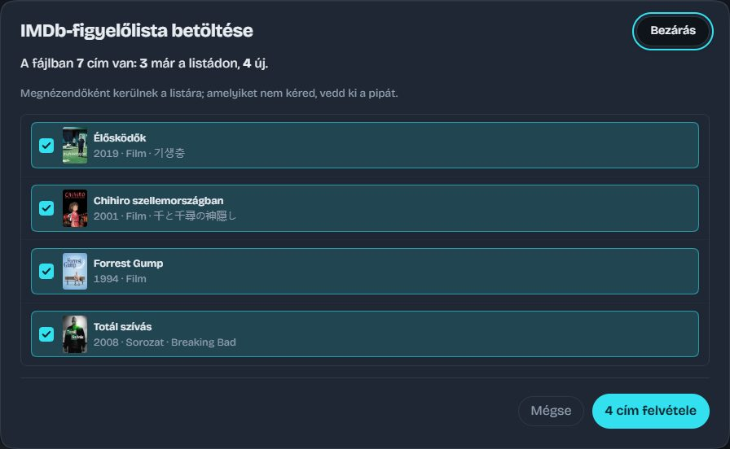

**Az IMDb-figyelőlistád (Watchlist) átvétele:**
1. Az IMDb-n a figyelőlistád oldalán töltsd le az exportot (CSV-fájl).
2. Az appban: ⋮ → IMDb import → válaszd ki a fájlt.
3. Az app megmutatja, hány cím van a fájlban, ebből mennyi van már a listádon, és mennyi az új; az
   újakat megkeresi a TMDB-n (címenként egy pillanat).
4. Az új címek listája borítóval, magyar címmel, évvel, típussal – alapból mind kipipálva; amelyik
   nem kell, abból vedd ki a pipát. Amit a TMDB-n nem talált, azt alul felsorolja.
5. **„N cím felvétele”** – Megnézendőként kerülnek a listádra.

Az epizódok, játékok, podcastok kimaradnak. Teljesen automatikus szinkron sajnos nincs (az IMDb-nek
nincs erre nyilvános felülete).

## 13. Statisztika

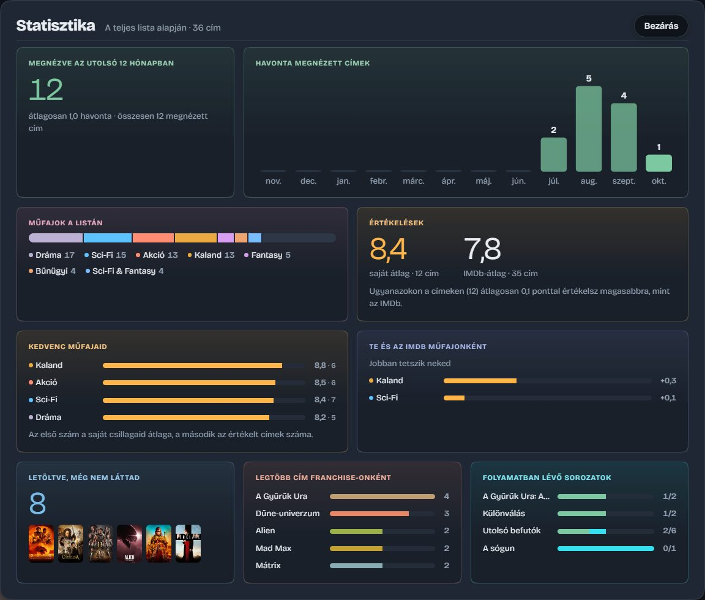

⋮ menü → **Statisztika** – kíváncsi vagy, mennyit néztél mostanában? A listádból számolt csempék,
mindegyik saját, halk színnel (a havi oszlopok közül a mostani hónapé teljes erővel, a franchise-ok
sávjai a franchise saját színében):
- Megnézve az utolsó 12 hónapban
- Havonta megnézett címek (oszlopdiagram, a megnézés napja alapján – lásd [6.](#6-állapotok-letöltve-értékelések))
- Műfajok a listán (a műfajszínekkel)
- Értékelések (saját és IMDb-átlag – kiderül, szigorúbb vagy-e az IMDb-nél)
- **Kedvenc műfajaid** – a saját csillagaid átlaga műfajonként, a legjobb öt; a „8,8 · 6” azt jelenti:
  8,8-as átlag 6 értékelt címből
- **Te és az IMDb műfajonként** – hol értékelsz jobbra, mint az IMDb („Jobban tetszik neked”,
  borostyánnal), és hol vagy szigorúbb („Szigorúbb vagy”, szürkével), legfeljebb 3-3 műfaj, pl.
  „+0,3” vagy „−1,5”. Egy műfaj legalább 3 értékelt címtől számít – addig magyarázó szöveg áll a
  helyén
- Letöltve, még nem láttad
- Legtöbb cím franchise-onként
- Folyamatban lévő sorozatok (évadhaladás)

## 14. Mentések és adatbiztonság

A listádra többszörösen vigyázunk, nem kell izgulnod miatta.

**Automatikus heti mentés:** hétfőnként hajnalban mentés készül a listádról (címek, franchise-ok,
évadok, értesítések, nézési sorrendek, elrejtett ajánlások); a 8 hétnél régebbiek törlődnek. (A 2026.
10. 06. előtti mentések nézési sorrend nélkül állnak vissza.)

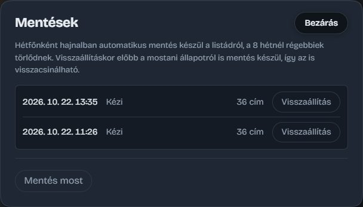

**⋮ menü → Mentések:**
- a mentések listája: dátum, fajta (*Heti* / *Kézi* / *Visszaállítás előtt* / *Feltöltött*), címek
  száma;
- **Mentés most** – azonnali mentés (pl. egy nagyobb átrendezés előtt, a biztonság kedvéért);
- **Visszaállítás** – megerősítés után a lista a mentés állapotára áll vissza. Előtte a mostani
  állapotról is mentés készül („Visszaállítás előtt”), így még a visszaállítás is visszacsinálható.

**Külső másolat:** hetente egy másolat a GitHubra is kerül (56 napig őrzi). Ha valaha az egész
adatbázis elveszne, ebből Claude vissza tudja tölteni a „Mentések” közé („Feltöltött”), és onnan a
szokásos módon visszaállítható.

**A gépeden tárolt lista:** hogy net nélkül is elinduljon (lásd [1.](#1-belépés-és-telepítés)), az
app a böngészőben megőrzi a legutóbb látott listádat. Ez csak egy másolat a gyors induláshoz – a
módosítások mindig az adatbázisba mennek. **Kilépéskor** a másolat törlődik, így egy közös gépen
sem marad ott a listád.

**Mentés letöltése** (⋮ menü, csak széles képernyőn): a teljes lista egyetlen CSV-fájlban, ami
Excelben dupla kattintással szépen megnyílik – típus, cím, év, állapot, letöltve, dátum,
értékelések (a Rotten Tomatoes és a Metacritic is), Mama, franchise, műfajok, évadok, hozzáadás
dátuma, IMDb / TMDB azonosító.

**Hibák – ha valami elromlott** (⋮ menü, csak akkor látszik, ha van mit mutatni): ha a böngészőben
valami hibára fut – nálad vagy Mamánál –, az app feljegyzi. A menüpont mellett az olvasatlanok száma
(„Hibák (2)”). Az ablakban soronként a hiba fajtája („Váratlan hiba”, „Sikertelen mentés /
betöltés”…), „Új” és „Mamánál” jelölés, hányszor és mikor fordult elő, a **Részletek** alatt pedig
minden, ami a javításhoz kell. A **Másolás** a teljes leírást a vágólapra teszi – így
továbbküldheted Claude-nak; **Törlés** soronként, alul **Összes másolása** és **Összes törlése**
(megerősítéssel). Az ismétlődő hiba egy sorban, darabszámmal áll; a 30 napja nem ismétlődöttek
maguktól törlődnek. A hálózati hibák (pl. net nélkül) nem kerülnek ide.

## 15. Telefonon

  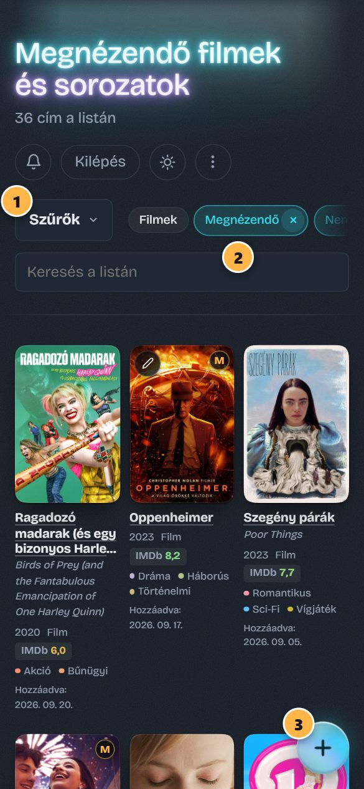
  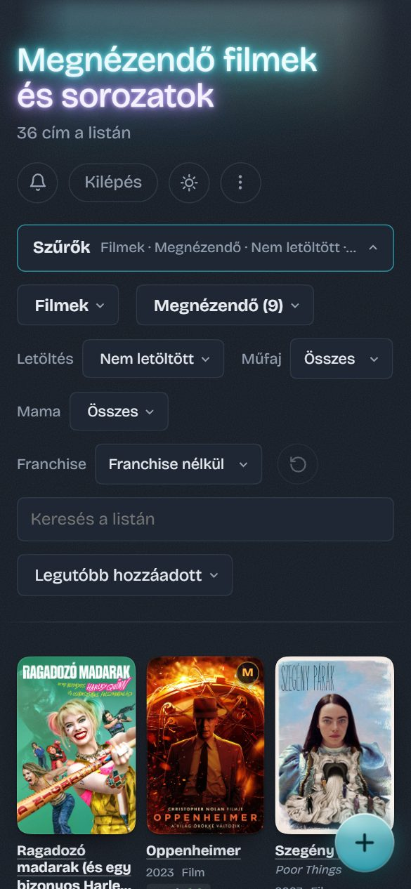
  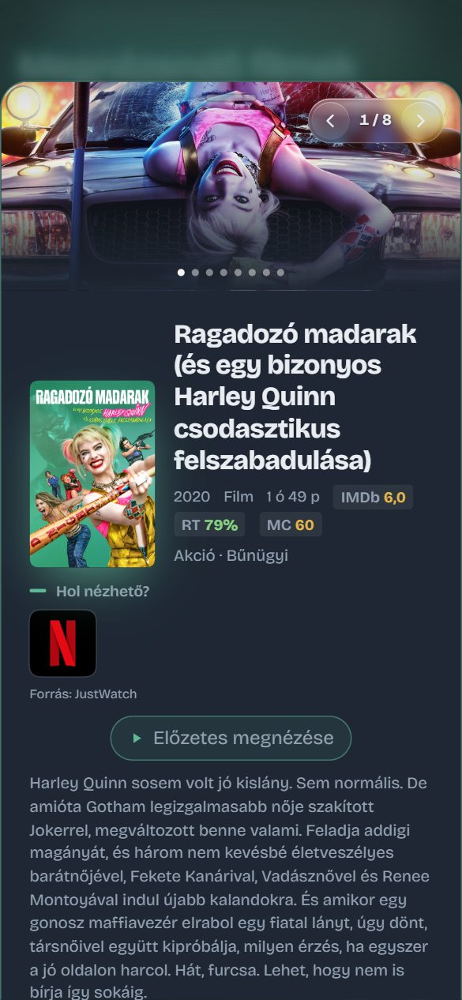

Zsebben is ugyanaz a lista, csak a képernyőhöz igazítva (640 px alatt):
- **3 kártya egy sorban**, kisebb betűkkel; a „Letöltve” jelvény csak ikon, mellette Mama „M”-je.
- ① **Szűrők összecsukva:** „Szűrők” gomb, ② mellette a beállított szűrők **címkeként** (pl.
  „Filmek”, „Megnézendő ×”, „Nem letöltött ×”, „Franchise nélkül ×”) – a **×** egy koppintással
  leveszi az adott szűrőt (Összes / Mind lesz), ha pedig eltértél az alapállapottól, a sor végén ott a
  **↺ Alaphelyzet**. A címkesor oldalra húzható. Kinyitva (középső kép) minden szűrő és a rendezés, a
  gombban röviden a beállítás. A kereső mindig látszik.
- ③ **Lebegő „+”** a jobb alsó sarokban (Cím hozzáadása) – áttetsző, csillanó türkiz üveg; lefelé
  görgetéskor félrehúzódik, hogy ne takarjon. Megnyomva a lap tetejére visz, ahol a panel nyílik;
  amíg a panel nyitva van, a „+” nem látszik (ne takarja a találatokat).
- **A fejléc** lefelé görgetve itt is keskeny sávvá csukódik („Megnézendő filmek”, harang, Kilépés,
  téma, ⋮).
- **Lehúzás frissítéshez** (a telepített appban): a lap tetején lefelé húzva kis kör jelenik meg;
  ha türkiz keretet kap, engedd el, és a lista frissül.
- **Vissza-gesztus / Vissza gomb:** a nyitott ablakot vagy menüt zárja, az adatlapon a lapokat
  lépteti vissza (film → színész → film) – nem lép ki az appból.
- **Minden ablak alsó lap** – az adatlap (jobb oldali kép) és a többi is (Statisztika, Toplisták,
  Franchise-ok, Mentések…): alulról felcsúszik, legfeljebb a képernyő nagy részét foglalja el, a
  tetején fogantyú – lefelé húzva bezárul. „Bezárás” gomb itt nincs. Ha épp nem zárható (pl. beírt
  jelszó, megerősítés), a lap visszaugrik. (Mama adatlapja a saját ×-ét és fogantyúját tartotta meg.)
- Az adatlapon fent a jelenetkép, a kép aljára úszik a kis borító, mellette a cím. A jelenetkép
  lapozható (jobbra fent „‹ 1 / 8 ›”, ujjal húzva is), koppintva nagy nézetben nyílik. A Hasonló
  címek csukva indul, a szereplők egy sorban, a leírás alatt látszanak; az alsó gombok középen.
- Az állapotszűrő és a Letöltés itt lenyíló a gombsor helyett; a lapozó csak nyilakkal.
- A Felfedezés kiemelt sávjában ujjal húzva lapozhatsz; a kép fent, a szöveg alatta van.
- **Telefonon nincs:** lista nézet, Tömeges import, Mentés letöltése (ezek 1400 px-től érhetők el) és
  az IMDb import (tableten már megvan).

## 16. Billentyűzet, kényelmi apróságok

- **Esc** bezárja az adatlapot, a menüket és a felugró paneleket (a képek nagy nézetében csak azt;
  szerkesztés – pl. átnevezés – vagy megerősítés közben csak azt zárja, az ablak nyitva marad).
- **Vissza gomb** (egér oldalsó gombja, Alt+←, telefonon a vissza-gesztus): a legfelső nyitott ablakot
  vagy menüt zárja, nem lép ki az appból (lásd [5.](#5-egy-cím-adatlapja-és-szerkesztése)).
- **Kikattintás:** asztalon (és tableten) elég az ablak mellé, a sötét háttérre kattintani, és
  bezárul bármelyik ablak – az adatlap, a Statisztika, a Franchise-ok, a gyűjtemény-ablak, a
  Színészek és rendezők, a Toplisták, a Mentések, a Hibák, a Jelszó módosítása (üresen) és a
  Felhasználói leírás. Nem zárul be, amíg valamit szerkesztesz, megerősítesz vagy épp felveszel benne
  (pl. átnevezés, visszaállítás megerősítése, mentés folyamatban) – ilyenkor megbillen. Telefonon a
  lehúzás / Esc / Vissza zár. Az importablakok (Tömeges import, IMDb import) kikattintásra nem
  zárnak – nehogy egy félrekattintás elvigye a begépelt listádat; ott a **Bezárás** gomb.
- A **⋮ menüben**, a **franchise-** és a **műfajszűrőben** nyilakkal, Home / End-del lehet lépkedni,
  Enter választ; a lenyílók (Típus, Rendezés…) Szóközzel nyílnak, nyilakkal és Enterrel választhatsz.
- A **csillagok** nyilakkal is állíthatók.
- A fejléc felugró listái (harang, ⋮) mindig a képernyőn belül nyílnak.
- **Felhasználói leírás:** ez a kézikönyv a ⋮ menüből az appon belül is olvasható (fent
  **Tartalom** – vissza a tartalomjegyzékhez), telefonon és net nélkül is.
- **Gyorsabb adatlap:** ha egérrel egy kártyán vagy soron állsz egy pillanatig, az app előre betölti
  az adatlap adatait – kattintásra azonnal ott vannak.
- **Kevesebb mozgás:** ha a Windowsban / telefonon be van kapcsolva az „animációk csökkentése”, az
  app minden animációt kikapcsol (a fejléc ilyenkor egyből csukódik, nem fokozatosan).
- Windows nagy kontrasztú módjában a rendszer saját vezérlői látszanak.

## 17. Honnan jönnek az adatok?

- **TMDB** (The Movie Database) – címek, magyar leírások, borítók, háttérképek, jelenetképek,
  műfajok, évadok, megjelenési dátumok, előzetesek, szereplők és színészek adatai, ajánlások,
  franchise-logók és -gyűjtemények. A címek adatai havonta frissülnek innen (lásd
  [2.](#2-a-lista-nézetek-és-lapozás)). A lap alján ott a kötelező forrásmegjelölés.
- **OMDb** – az IMDb-értékelések (ha épp nem elérhető, az app értékelés nélkül is működik).
- **JustWatch** (a TMDB-n keresztül) – a „Hol nézhető?” szolgáltatói adatai.
- **A magyar szinkron** a TMDB-n nem szerepel, ezért a Felfedezés csak közelítés (lásd
  [4.](#4-címek-felvétele)).
- A listád a Supabase adatbázisban van, és csak a saját fiókoddal látható. Mama fiókja ebből csak
  annyit lát, amennyi az oldalához kell (a fent leírt filmek adatai, a te értékeléseid és állapotaid
  nélkül), és csak a Mama-jelölést tudja módosítani – mást nem.

---

## 18. Mérföldkövek

Az app nagyobb állomásai – mikor jelent meg egy-egy fontosabb funkció. (Az apró javítások és
finomítások nem szerepelnek itt; a fenti témák mindig a mostani állapotot írják le.)

| Dátum | Mi jelent meg |
|---|---|
| 2026. 10. 22. | „Hányat láttál belőle?” a Toplistákban ([4.](#4-címek-felvétele)); gyorsabb keresés a listán. |
| 2026. 10. 21. | Rotten Tomatoes és Metacritic az IMDb mellett, színskálás értékelések ([12.](#12-imdb)); a sorozat állapota és a játékidő az adatlapon ([5.](#5-egy-cím-adatlapja-és-szerkesztése)); egységes „Bezárás” asztalon és lehúzható alsó lap telefonon minden ablakban ([5.](#5-egy-cím-adatlapja-és-szerkesztése), [15.](#15-telefonon)). |
| 2026. 10. 20. | Toplisták ([4.](#4-címek-felvétele)); színészek és rendezők a keresőben, „Kit érdemes követned?” ([4.](#4-címek-felvétele), [5.](#5-egy-cím-adatlapja-és-szerkesztése)); hibanapló ([14.](#14-mentések-és-adatbiztonság)); a bejelentett új évad dátuma a sorozat borítóján ([7.](#7-sorozatok-és-évadok)). |
| 2026. 10. 19. | Neonfelirat a fejlécben és a választható videotéka-téma ([2.](#2-a-lista-nézetek-és-lapozás)). |
| 2026. 10. 17. | Kedvenc színészeid és rendezőid követése: Színészek és rendezők ablak, idővonal, értesítés az új filmjükről ([5.](#5-egy-cím-adatlapja-és-szerkesztése), [11.](#11-értesítések)); új asztali szűrősor ([3.](#3-szűrés-keresés-rendezés)); a Felfedezés csak újdonságokat mutat ([4.](#4-címek-felvétele)). |
| 2026. 10. 16. | Mama oldalán egyszerre öt film ([10.](#10-mama-jelölések)); görgetéskor félreálló fejléc asztalon ([2.](#2-a-lista-nézetek-és-lapozás)). |
| 2026. 10. 15. | Moziszerű adatlap asztalon; görgetéskor összecsukódó fejléc, üveges szűrősor ([5.](#5-egy-cím-adatlapja-és-szerkesztése), [2.](#2-a-lista-nézetek-és-lapozás)). |
| 2026. 10. 14. | Azonnali mentés az adatlapon, „Már láttam”, élő szinkron a gépek között, frissítés a TMDB-ről ([4.](#4-címek-felvétele), [5.](#5-egy-cím-adatlapja-és-szerkesztése)). |
| 2026. 10. 13. | A színész lapja; okosabb keresés (franchise neve, elírás); a Vissza gomb az ablakokat zárja ([3.](#3-szűrés-keresés-rendezés), [5.](#5-egy-cím-adatlapja-és-szerkesztése)). |
| 2026. 10. 12. | Jelszó módosítása ([1.](#1-belépés-és-telepítés)). |
| 2026. 10. 08. | Világos téma; net nélkül is elindul; megosztható nézési sorrend; ez a leírás az appon belül ([1.](#1-belépés-és-telepítés), [2.](#2-a-lista-nézetek-és-lapozás), [9.](#9-franchise-ok-és-gyűjtemények)). |
| 2026. 10. 07. | Mama saját oldala ([10.](#10-mama-jelölések)); „Kiemelt a mozikban” és „Neked ajánlott” a Felfedezésben; franchise-javaslat felvételkor; gyorsindítók ([4.](#4-címek-felvétele), [1.](#1-belépés-és-telepítés)). |
| 2026. 10. 06. | Nézési sorrend a franchise-okban; „Nem érdekel” az ajánlásokon; képes felhasználói leírás ([9.](#9-franchise-ok-és-gyűjtemények), [4.](#4-címek-felvétele)). |
| 2026. 10. 05. | Franchise-ok ablak; adatlap a listára vétel előtt ([9.](#9-franchise-ok-és-gyűjtemények), [4.](#4-címek-felvétele)). |
| 2026. 10. 04. | Az első teljes változat: lista és szűrők, adatlap, évadok, franchise-gyűjtemények, még meg nem jelent filmek, „Hol nézhető?”, IMDb import, Felfedezés, automatikus heti mentés – és ez a felhasználói leírás. |
